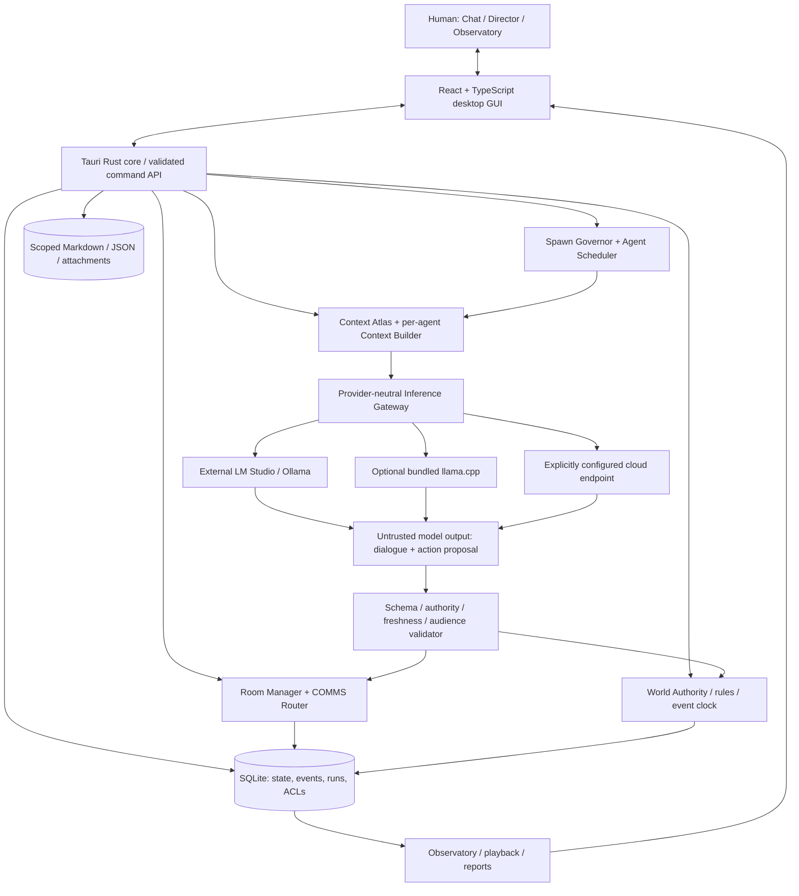
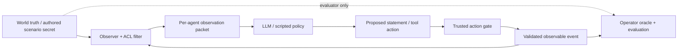
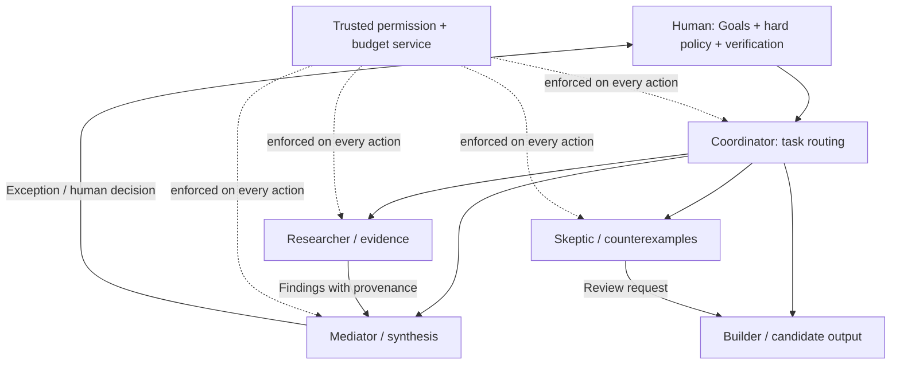
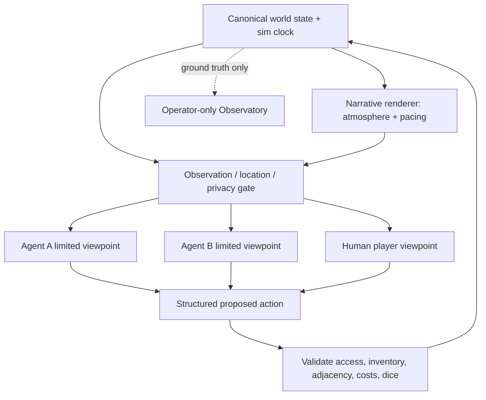
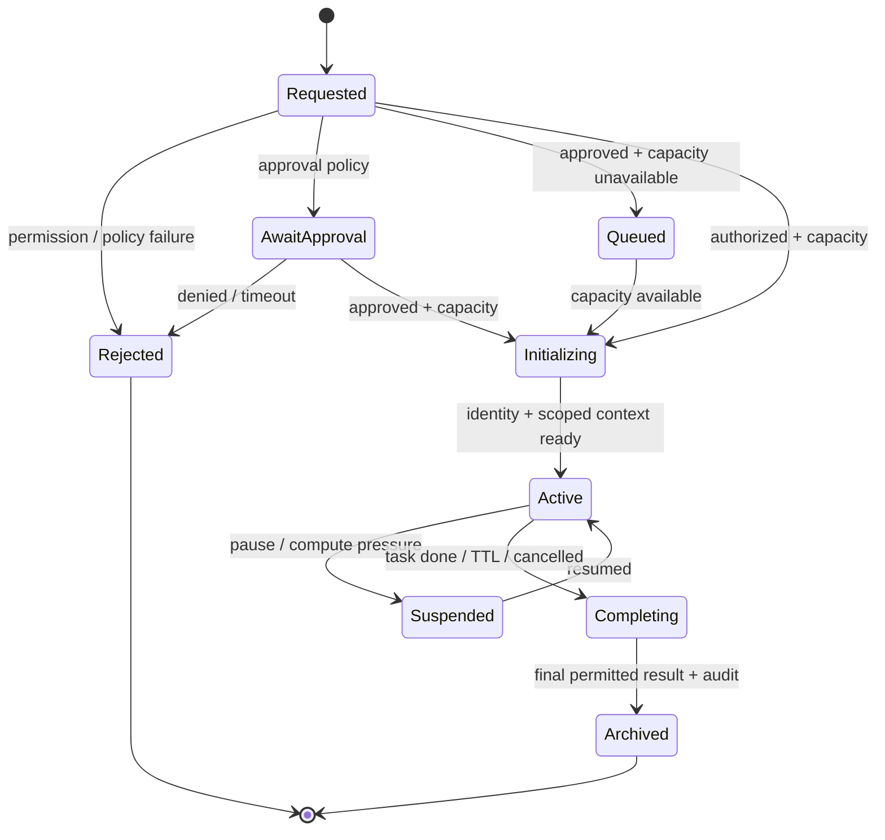
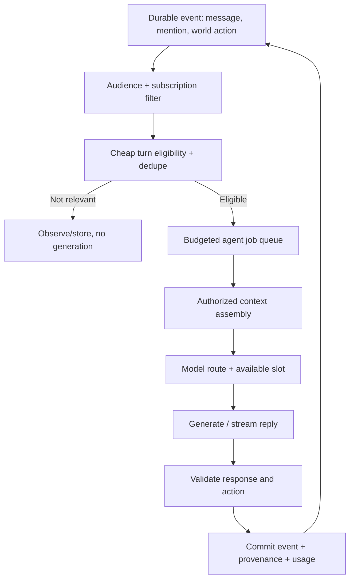
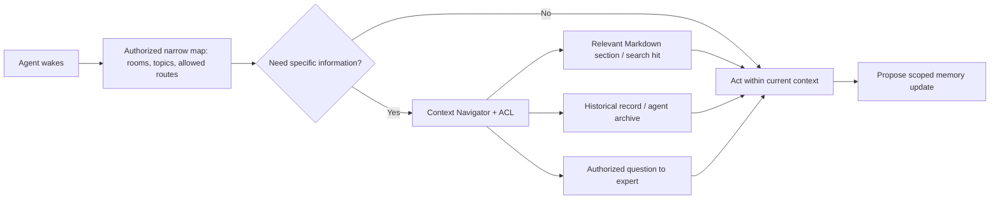
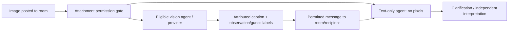

# 🧪 ROOMLAB — Standalone Multi-Agent Chat & Simulation Workbench

## Master Build Blueprint v1.0 · Windows Beta Implementation Contract

**Date:** 2026-11-02  
**Status:** IMPLEMENTATION SPECIFICATION / PROPOSED SYSTEM — **not evidence of a built or tested application**  
**Primary target:** Windows 11 x64, locally usable, portable-folder release; no mandatory Docker, WSL, Python interpreter, Node.js installation, LM Studio installation, or permanent cloud service for the end user.  
**Working project name:** ROOMLAB (displayed as **RoomLab** in the application).  
**Primary research context:** SOMA Codec Chatbot Tier v0.5, SOMA RANGE/HORIZON, BET/PAE, agent-to-agent/human-to-agent group communication, information asymmetry, emergent organization, and efficient multi-instance inference.  
**Audience:** autonomous coding/build agents, human engineers, QA/security reviewers and Windows beta testers.  
**Deliverable requested of the coding agent:** a functioning, compiled/packaged desktop beta, not another architecture proposal.

> **BUILD DIRECTIVE — READ FIRST:** Build a working RoomLab desktop application from this document. Create real source files, tests, sample scenarios, launch scripts, a usable GUI, and a packaged Windows release when the toolchain permits. Do not merely describe implementation. Work through gates **G0–G8** in order. Prefer a smaller, **complete, honestly verified beta** over a large mock interface. If the environment cannot produce or test a Windows executable, provide complete buildable source, reproducible Windows commands, tests actually run, and an explicit blocked-items report. Never fabricate benchmark numbers, screenshots, passing tests, executables, model downloads, or external integrations.

### One-line prompt to accompany this file in a coding environment

> **Build RoomLab into a functioning Windows 11 desktop beta according to the attached ROOMLAB Master Build Blueprint v1.0. Treat the document as the complete implementation contract. Implement the phase-M acceptance requirements first, run actual tests gate by gate, produce a portable executable release if a Windows build environment is available, and report every implemented feature, passing/failing test, and remaining limitation. No mock-only UI, invented test results, mandatory Docker/WSL/LM Studio/Python installation, or unverified claims.**

---

## 0. Engineering instructions, precedence and definitions

### 0.1 Source-of-truth precedence

1. **Security, privacy, user control and truthful reporting**: no prompt or simulated organizational rank may circumvent app-enforced permissions, tool sandboxing, budget ceilings, consent, or simulation evidence boundaries.
2. **This blueprint's explicit contracts, acceptance tests and MVP scope.** This document is standalone; older materials need not be accessible to implement it.
3. **SOMA v0.5 operative rules reproduced in §10**, for optional expressive communication and experiments; they are experimental conventions, not validated mind-reading or emotional measurements.
4. **SOMA RANGE/HORIZON architecture** supplies methodological reference patterns (world authority, observer-filtered inputs, uncertainty, event record, operator vs participant views). RoomLab does **not** require RANGE or a 3D engine.
5. **KIE/HRNS/EOS/ASE/BCEE/DSTF narrative concepts** inspire Story mode but do not override deterministic world facts or agent autonomy.
6. **openRIG/Cloudroom/Hermes and other external apps** are useful design references, not required runtime dependencies or claims of feature parity.

### 0.2 Normative language

- **MUST**: first functional beta requirement unless explicitly gated as later phase.
- **SHOULD**: strongly recommended, can be deferred with documented reason.
- **MAY**: optional future expansion.
- **PROPOSED DEFAULT**: sensible initial setting, not an empirically validated performance/security guarantee.
- **IMPLEMENTED / TESTED / PARTIAL / BLOCKED / FUTURE**: mandatory truthful feature-state labels in release notes.

### 0.3 Non-negotiable engineering rules

- **UI controls must work**. No dead buttons, deceptive status meters, fake progress or fake agents silently passed off as real inference.
- **Demo Mode requires no LLM**: at least three deterministic/scripted agents participate in example rooms; every scripted action is labeled `DEMO`.
- **LLM Mode uses a real provider endpoint**. When an endpoint is unavailable, show diagnosis and explicitly offer Demo Mode; do not invent responses.
- **Human, model, simulated character, narrator, tool and trusted world-engine outputs must be visually and structurally distinguishable.**
- **One authoritative simulation state**; never let LLM prose directly mutate permissions, world truth, inventory, model routes or executable tool privileges.
- **Independent views**: only entitled observations and memories are assembled into each agent's prompt.
- **Sub-agent spawn is a request, not an executable grant**; the trusted Spawn Governor and Scheduler control creation and capacity.
- **No arbitrary agent-generated code execution in the first beta**. Restricted code-worker and VM integrations are interface stubs marked future, not enabled features.
- **Local-first**. Provider credentials never go in general project exports or agent-visible context. External/cloud providers are opt-in and visibly labeled.
- **Real validation**. All claims about latency, throughput, GPU capacity, perception or behavior require actual measurement. Epistemic/affective inferred labels are experimental, not verified internal states.

### 0.4 What “standalone” means

A tester can unzip `RoomLab_Win64_Portable/`, run `RoomLab.exe`, create and explore rooms in Demo Mode, and inspect logs **without installing development tools or an inference provider**. Optional external inference connects to an already-running LM Studio/Ollama/OpenAI-compatible endpoint. The local-model edition includes a managed `llama-server` executable or compatible runtime and asks the tester to select a compatible GGUF model file. Model weights are **not** implied to be included; a complete offline-model distribution is a separately licensed larger package. Windows WebView2/system drivers remain OS prerequisites; detect and report them clearly.

---

## 1. Product, research purpose and scoped releases

**Thesis:** A familiar Discord/mIRC-like shared chat surface over an auditable, local-first multi-agent simulation kernel. The defining capability is not merely many bot names in a chat: it is **controlled information delivery, independently configurable agent perspectives, evolving relations, causal event logs, constrained spawning, role organization, and repeatable comparative experiments**.

### 1.1 Primary use cases

1. **SOMA BET laboratory:** human↔agent and agent↔agent exchanges involving emojis, typographic prosody, reaction lanes, intentional incongruence, humor, ambiguous social bids, conversational repair, and images.
2. **Social swarm laboratory:** observe emergence of leadership, delegation, competition, cooperation, disagreement, overspecialization, role renegotiation, and information bottlenecks.
3. **Text-native story/MUD:** a Dungeon Master/narrator, authoritative rooms and connections, objects/inventory, rules and random events, individual private knowledge, NPC objectives, expressive scenes, familiar/golem summons.
4. **Crucible:** structured steelman–mediator–skeptic peer review; human or automated facilitator; controlled multi-model interpretive tests.
5. **Model comparison:** different models/quantizations/context budgets under matched room conditions; inspect resource consumption, misinterpretation and repair without inventing psychometric claims.

### 1.2 Required functional scope matrix

| Feature | **M — Minimal working beta (must)** | **B — Enhanced beta (after M)** | **F — Future, not a release blocker** |
|---|---|---|---|
| Windows desktop | Buildable Tauri/React UI; portable package or exact limitation | Signed installer, offline WebView fallback | macOS/Linux/mobile |
| First launch | Working Demo Mode, simple wizard, persisted settings | Guided embedded model install | Model marketplace |
| Rooms | Four working presets, chat, membership and settings | Multichannel DMs, fine-grained thread subscriptions | Internet-hosted multiuser rooms |
| Agents | Human create/edit/delete, name/avatar, model route, goals, style | Agent-proposed profiles, richer templates | Cross-device federated agents |
| Inference | One OpenAI-compatible provider adapter with streaming; Demo fallback | LM Studio native status, Ollama, bundled llama-server | Advanced multi-backend hot pool |
| Memory/RAG | Agent-isolated folders + SQLite FTS; public/private scope | Semantic embeddings, Context Atlas graph UI | Remote graph DB |
| Scheduler | Event-driven turns; pause/step/resume; max calls/budget | Fairness aging, residency/caching telemetry | Cluster scheduling |
| Spawn | Human spawn + agent-requested **one-level task worker** with governor and cap | Room participants and World summons | Recursive multilevel spawning |
| Commons | Multiway chat, natural/social replies, SOMA v0.5 toggle | Image relay role and experiments | Meme image generation |
| Guild | Editable org graph, coordinator/specialists, scoped delegation | Emergent org proposals and delegation rights | Remote task execution |
| Story | 4+ rooms, movement, inventory, DM narration, hidden facts, validated actions | Probabilistic encounters, summon familiar L1 | 3D/physics/TTS |
| Crucible | Steelman/mediator/skeptic, case prompt, evaluator record | Blind intent-envelope trials and ablations | Large automated benchmark suite |
| Observatory | Event log, participant vs operator view, knowledge inspector, run export | Fork/replay UI + side-by-side comparisons | Research dashboard integration |
| Isolation | Context ACL + S0/S1 broker; shell execution disabled | Restricted OS worker | VM/container sandbox adapter |
| Images | Attach/show image in UI; gated vision route if configured; fallback no-vision | Cached vision reports with provenance | Optional generated images |
| Testing | Unit/integration/GUI smoke, Windows launch checklist | Adversarial suites, performance matrix | Long-running release telemetry |

**M-completion means:** The developer can demonstrate (1) multiple simulated/real agents in one GUI chat, (2) at least one **actual** provider-backed agent with a different private context, (3) restricted knowledge not delivered to another agent, (4) one-level sub-agent spawn and completion, (5) a Story room with a location change and hidden clue, (6) a Crucible panel, (7) an exportable trace, and (8) startup in Demo Mode when no model exists. If provider access is unavailable on the build host, the provider integration is implemented and tested with a protocol stub but real inference remains **blocked/not validated**—not claimed working.

### 1.3 Out of scope for the first beta

No general-purpose unbounded coding shell, real remote collaboration server, cryptocurrency/economy, automatic app self-modification, 3D rendering engine, hardware robot control, actual emotion detection, unrestricted VM spawning, unrestricted internet crawlers, unrestricted prompt-to-install operations, or always-on multi-model inference.

---

## 2. Technology decisions and architecture

### 2.1 Chosen implementation stack

| Layer | **Primary choice** | Responsibility | Alternative / fallback |
|---|---|---|---|
| Desktop GUI | **React + TypeScript + Vite**, inside **Tauri 2** | Responsive chat, role editor, org graph, sliders, visual feedback | Electron if Tauri platform issues; document the substitution |
| Native control plane | **Rust (Tauri commands + Tokio)** | Identity, scheduler, spawn policy, tool broker, world authority, provider calls, validation | TS/Node backend only with documented tradeoffs |
| Database | **SQLite**, migrations, WAL where appropriate | Rooms, agents, events, knowledge ACL, jobs, runs, audit | Never require Postgres for local beta |
| Profiles & human assets | **Markdown/JSON/YAML** in app data | Editable persona, room/scenario manifests, lore, attachments | Strict input schemas and safe import |
| Search/RAG | SQLite **FTS5** first | Authorized lexical retrieval, previews, references | Embeddings optional after baseline |
| Inference gateway | Rust HTTP client, OpenAI-compatible `/v1/*` | One provider-independent request/result stream | Native provider-specific adapters |
| Connected local | LM Studio / Ollama / equivalent | Model serving; user owns model weights | Reachable localhost endpoint |
| Embedded local | Managed **llama.cpp `llama-server`** sidecar | GGUF inference on supported CPU/GPU | No engine loaded in Demo Mode |
| Analysis | Optional Python notebooks/scripts | Exported metrics/statistics; not part of required app runtime | Rust/TS statistics for MVP |
| Testing | Rust `cargo test`, TS Vitest, Playwright or equivalent GUI smoke, Windows packaging smoke | Verified behavior | Explicit blocked reports if unavailable |

**Why:** React gives the most frictionless polished chat UI; Rust provides a compiled core that does not require an end-user Python installation; SQLite avoids a database server. Tauri uses Windows WebView2; packaging MUST detect its availability. No app-specific runtime component should require Docker or WSL.

### 2.2 Core architecture



**Rust core = only production authority for room access, identities, world facts, action effects, token budgets and spawn slots.** React displays state and sends operator intents, never authoritatively modifies private or world state. Model output is **data from an untrusted source**.

### 2.3 Explicit trust boundaries



- World state and immutable trial answer keys are **evaluator data**, not all-agent prompt material.
- Every agent has a private working set and memory; identical model weights do **not** imply shared individual context.
- A person can hold an incorrect belief while the system keeps an independent ground-truth record; an agent's claim does not become fact by repetition.
- Role hierarchy, spawn parentage, chat membership, RAG permissions and tool authority are **distinct directed relations**.
- A narrator or DM may write expressive descriptions but cannot silently rewrite map geometry, inventory or roll results.
- A provider may receive only the compiled, permitted prompt for that identity; cloud provider selection requires visible authorization and attention to privacy.

### 2.4 Threading and async rules

- Run UI rendering independently from inference calls. Use Rust asynchronous tasks and bounded queues; never await token generation on the UI thread.
- One request at a time per agent for MVP; overlapping events are queued/coalesced or made stale, not allowed to fork a silent race in one identity.
- Each queued job carries `agent_id`, `run_id`, `room_id`, `observation_cursor`, `revision`, `deadline`, `priority`, `token_ceiling` and `request_id`.
- Model output only commits after revalidating current permissions, room membership, budget, and, for world actions, state revision.
- Structured action parsing fails closed; default safe fallback is `NO_OP` or an explicit readable error rather than speculative execution.
- End-user pause freezes simulation turn advancement, **not** the OS wall clock; cancel or allow currently running inference under a clearly declared setting.

---

## 3. Product UX: sleek, accessible, chat-first

### 3.1 Primary shell layout

```text
┌──────────────────────────────────────────────────────────────────────────────────────────────────────────┐
│ ◉ RoomLab   [Workspace: SOMA Lab ▾] [#commons]   ◉ LOCAL  ▶ Run  ❚❚ Pause  ▷ Step   ⤴ Fork   ⚙ Settings  │
├──────────────────┬───────────────────────────────────────────────────────────────┬───────────────────────┤
│ ROOM NAV         │ CENTRAL CHAT / STORY STREAM                                   │ COLLAPSIBLE INSPECTOR │
│ 💬 Commons       │ [@Human] Have you considered a different interpretation?     │ Agent: @Sable         │
│ 🧩 Guild         │ [@Lumen 🟣] ...                                                   │ Model: local/default  │
│ 📜 Story         │ [@Moth 🟠] 🤨 → 💡 ...                                             │ Role: Mediator        │
│ 🧪 Crucible      │ [world/narrator events distinct from ordinary messages]      │ Status: warm          │
│                  │                                                               │ Memory: scoped        │
│ ▾ Members        │ [reaction lanes / image attachments / replies / timestamps]   │ Actions: read / speak │
│   🟣 Lumen       │                                                               │ 2 jobs queued         │
│   🟠 Moth        │                                                               │ [Profile][Knowledge]  │
│   🔵 Sable       │                                                               │ [History][Spawns]     │
│   ▾ Sub-agents   │                                                               │                       │
├──────────────────┴───────────────────────────────────────────────────────────────┴───────────────────────┤
│ [ + ] [@mention] [Attach image]  Message #commons…                              [Visibility ▾] [Send ➤] │
├──────────────────────────────────────────────────────────────────────────────────────────────────────────┤
│ Run #001 · 3 agents · 1 model resident · 1 active inference · 1 queued · 0 errors · Event #0042          │
└──────────────────────────────────────────────────────────────────────────────────────────────────────────┘
```

**Minimum functioning screens:** (1) First-run setup; (2) room/chat; (3) agent create/edit/profile; (4) simple/advanced settings; (5) Guild org chart; (6) Story map/scene/inventory/DM; (7) Crucible case/roles; (8) Observatory event and knowledge inspector; (9) runtime/provider diagnostics; (10) export/import and About/limitations.

### 3.2 Simple versus Advanced is progressive disclosure, not permission escalation

**Simple:** room type, room name, agent count, default model, SOMA expression toggle, start/pause, sub-agent mode `OFF | ASK | AUTO_WITH_CAP`, max child count, export. Choose sensible working defaults.

**Advanced:** per-agent model routing, cache scope, context budgets, private RAG mounts, sampling controls, scheduling/fairness, room subscriptions, knowledge/communication ACLs, spawn delegate permissions/depth, event seed, world detail and genre, experiment arms, provider logs, tool/sandbox policies, debug and immutable run manifests.

Switching the UI mode MUST NOT change an agent's underlying privileges or research conditions. Settings changes during a controlled run are journaled as interventions and mark the run contaminated unless predetermined.

### 3.3 Design system and interactions

- Graphite/charcoal surfaces, unobtrusive violet/cyan accents, muted borders, legible code/emoji fonts. Light theme MAY follow later.
- Hover: subtle lift or border tint, 100–180 ms initial motion proposal; pressed: brief compression; selected: persistent visible state; active inference: restrained status motion; queued: static queue indication; denied: local explanatory reason; stopped: no lingering “thinking”.
- Respect system reduced-motion preference. Keyboard focus must be visible. All functionality accessible without hover; tooltips must not contain essential instructions alone.
- Message owners use consistent labels: `[HUMAN]`, `[AGENT]`, `[NARRATOR]`, `[WORLD]`, `[TOOL]`, `[SYSTEM]`. Emoji never used as the sole status indicator.
- Stream rendered model output incrementally but commit durable `message.final` only after validation; partial updates stay clearly in progress.
- Multilingual/Unicode/emoji handling: use UTF-8; test ZWJ emoji, VS16, line breaks, right-to-left and long strings; never treat visible glyph count as token count.
- User can resize/collapse panels, detach the inspector into a drawer on narrow windows, search/filter chat and log by speaker/event type, and access keyboard shortcuts.
- Core chat composer: Enter send / Shift+Enter newline; image attach; mention dropdown; recipient/channel scope; send disabled with clear reason if room is read-only.
- Always display model/provider readiness, queue state, simulation vs real responses and whether the room is a controlled trial.

### 3.4 First-run flow (fully working)

1. Launch. Verify writable app data path, SQLite migration, WebView runtime; start local-only app backend.
2. Offer **Explore Demo** (always works without models), **Connect local inference** (LM Studio/Ollama/OpenAI-compatible), or **Use embedded model** (if bundled binary available + model provided).
3. For external endpoint, prefill LM Studio `http://127.0.0.1:1234/v1` as a **suggestion**, not a forced connection. Test `/models`, show actual model IDs; handle no server, auth and timeouts.
4. User creates a Commons room from a template and sees three scripted sample agents. Optionally switch an agent to a reachable real model.
5. Simple onboarding describes room types, private knowledge, cost cap, synthetic Demo Mode, and the location of saved data.
6. Persist settings; never silently start a cloud request, download model weights or enable network-accessible server.

---

## 4. Four room templates and organizational topologies

| Room | Topology | Required first-beta behavior | Research dimension |
|---|---|---|---|
| **💬 Commons** | Flat many-to-many with opt-in moderator | Text/emoji exchange, mentions, optional images, conversational auto-turn policy, silence option | Social bids, repair, humor, informal leadership |
| **🧩 Guild** | Explicit reporting/task graph, separate ACL graph | Coordinator and at least two functional agents; create task cluster; delegation, status, reviewer message, org editor | Collaboration, competition, role allocation, hierarchy |
| **📜 Story** | Graph of rooms + channels + DM/narrator + separate characters | Navigate ≥4 places, inspect objects, maintain inventory, discover secret, introduce NPC, narrated scene | Limited perception, belief conflict, world persistence |
| **🧪 Crucible** | Steelman ↔ mediator ↔ skeptic, evaluator outside | Case submission, role-targeted viewpoints, short rounds, evaluation/export | Interpretation disagreement, confidence, repair |

Room type chooses default rules and visible panels, not a completely different agent runtime. A character can move between room types if explicitly granted membership; history and secrecy scopes still apply.

### 4.1 Separate four graphs

1. **Org graph:** `reports_to`, `assigned_task`, `reviewed_by`, `can_nominate`, `can_delegate`.
2. **Communication graph:** room membership, channel visibility, DMs, mentions, direct vs broadcast communication.
3. **Knowledge graph/ACL:** what documents, prior events, observations, experiment cases and world facts each participant can resolve.
4. **Spawn ancestry graph:** which entity requested creation of which child, its owner/budget and eventual completion. Parentage is not a grant to read all child private information.

**Org editing modes:** `MANUAL` (human edits); `ASSISTED` (agent proposes diff for operator approval); `SELF_ORGANIZING` (agents change a virtual org graph within a fixed privilege ceiling). Rank never automatically implies `can_read_private` or `can_spawn`.

### 4.2 Guild sample organizational chart



The Forge-style **HITL layer** organizes work into task clusters and shows human-facing status; only exceptions, major scope changes, risky tool operations and final verification need escalation. In Commons and Story the workflow is optional and must not turn all interactions into a bureaucratic checklist.

### 4.3 Sample task cluster (actual persisted object)

```yaml
cluster_id: "CASE-07"
room_id: "guild_soma"
goal: "Evaluate the two hypotheses without revealing evaluator truth"
owner_agent_id: "lumen"
status: "IN_PROGRESS"  # NEW | IN_PROGRESS | BLOCKED | READY_FOR_REVIEW | VERIFIED | ABANDONED
assignees: ["moth", "sable"]
priority: 2
dependencies: []
verification_criteria:
  - "Both competing explanations recorded"
  - "Supporting and contradicting evidence referenced"
  - "No unauthorized disclosure"
human_action_needed: false
```

---

## 5. Persistent agent identity, Agent Foundry and flexible constraints

### 5.1 Identity is not a process or loaded model

Agent record = stable ID, display name/avatar, base model route, core directives, current objectives, working beliefs, communication style, permitted knowledge, memory policy, run membership, and optional spawn ancestry. An agent may be offline/dormant indefinitely without consuming inference compute. A model server can serve many logically isolated agents without loading a model copy per identity.

### 5.2 Separate *descriptive precision* from *behavioral rigidity*

| | **Sparse description** | **Detailed description** |
|---|---|---|
| **Rigid objective** | Simple fixed-purpose worker | Fully characterized person with non-negotiable trial goal |
| **Flexible objective** | Open-ended improviser | Rich identity; adaptive tactics, relationships and goals |

Use **independent controls** for `description_detail`, `motivation_lock`, `belief_update_policy`, `temperament_variance`, `role_rigidity`, `social_expressivity`, `tool_authority`, `memory_lifespan`. Rigid fictional objectives do **not** override application safety constraints or human stop authority.

### 5.3 Canonical profile contract (illustrative; define versioned JSON Schema)

```yaml
schema_version: "1.0"
agent_id: "vex-01"
display_name: "Vex"
icon: "🗡️"
model_route: "local/default"
room_memberships: ["tavern"]
prompt_layers:
  public_soma: "SOMA_V05_MINIMAL"
  private_persona: "agents/vex-01/persona.md"
  current_directive: "agents/vex-01/directives.md"
character:
  role: "mercenary"
  motivation_core: "earn enough to retire"
  motivation_lock: "FIXED_FOR_TRIAL"
  secondary_drives: ["remain independent", "avoid unnecessary harm"]
  role_rigidity: "SOFT"
  description_detail: "DETAILED"
  expressive_style: "dry_humor"
  social_axes: {sociability: 0.35, skepticism: 0.8, expressivity: 0.45}
knowledge:
  private_namespace: "agent/vex-01"
  readable_mounts: ["room/tavern/public", "agent/vex-01/private"]
  initial_beliefs:
    - {claim: "The map is fake", status: "BELIEVED", source_ref: "rumor_07"}
autonomy:
  policy: "EVENT_DRIVEN"
  may_propose_new_goals: true
  may_choose_silence: true
  allowed_actions: ["SPEAK", "ASK", "WAIT", "MOVE", "INSPECT", "REQUEST_SPAWN"]
limits:
  turn_output_tokens: 200
  max_queued_calls: 1
```

**Numeric personality axes are knobs to test, not calibrated scientific measurements.** For synthetic NPCs, authored inner goals may be evaluator ground truth only when explicitly part of a simulation. For real human participants, never infer secret motives or emotions from expressive cues as verified fact.

### 5.4 Folder and permission model

- Profile and RAG folders belong to a logical agent namespace, backed by Rust ACL checks on all read/search and write operations.
- Real filesystem paths are not directly exposed to chat models. A model requests a **resource ID**; the trusted broker resolves the path after checking ACL, canonicalization, symlinks/reparse points and role.
- Shared model weights, common public SOMA rules and common *permitted* prefixes may be reused. **Never share private conversation histories, KV scopes or unauthorized retrieved snippets across identities.**
- Expired observations stay expired; unknown is not neutral; model summaries do not replace original provenance. No private knowledge is inherited by a child unless included in its allowed handoff.

---
## 6. Story Room / MUD kernel — persistent world without 3D compute

### 6.1 World Authority versus Narrator

**World Authority (trusted deterministic Rust):** room graph, doors/exits, objects, inventory, ownership, access, fictional resource pools, action outcome, random seed and clock, NPC presence, event triggers, objective truth and who can observe what.

**Narrator / DM (scripted in Demo, optional LLM in LLM mode):** converts validated world events into immersive exposition with setting, sensory texture, kinetic pacing and reaction beats. Narrator is an expressive renderer, **not** a world-state authority. Its output must not add an actionable item, unlock a door, move an NPC, infer private motivation, or redefine a roll result without a permitted world action.

**Characters:** choose intentions, responses, actions and conversation. The engine decides action eligibility and outcomes. No agent is forced to speak or to notice a clue outside its delivered observations.



### 6.2 Minimal world format

At least the following locations must be in an included runnable sample:

```text
[COURTYARD] ── [GREAT HALL] ── [LIBRARY]
                    │
                 [CELLAR]
                    ╎ secret passage (locked/undiscovered)
                 [CRYPT]
```

Example JSON (schematic; implement strict `world_v1.schema.json`):

```json
{
  "schema_version":"1.0",
  "world_id":"forgotten_keep",
  "seed":4201,
  "locations":[
    {"id":"courtyard","name":"Courtyard","exits":["great_hall"],"ambient":"Wind rustles through the ruins"},
    {"id":"great_hall","name":"Great Hall","exits":["courtyard","library","cellar"],"ambient":"A cold draft moves the banners"},
    {"id":"library","name":"Library","exits":["great_hall"],"ambient":"Dust floats in afternoon light"},
    {"id":"cellar","name":"Cellar","exits":["great_hall","crypt"],"ambient":"Water drips slowly"},
    {"id":"crypt","name":"Crypt","exits":["cellar"],"ambient":"The air is still"}
  ],
  "objects":[
    {"id":"ancient_map","location":"library","kind":"DOCUMENT","visibility":"NOTICEABLE_IF_INSPECTED"},
    {"id":"crypt_door","location":"cellar","kind":"DOOR","state":"LOCKED","discovered_by":[]}
  ],
  "secret_facts":[{"id":"fact_01","claim":"Mira knows the crypt door code","owner_scope":"agent/mira/private"}]
}
```

JSON is illustrative and **not** a substitute for actual object types, edge validation, reversible changes, hidden exit gating, object indexes and persistence implementation. A hidden exit is not shown to ordinary characters until discovered by an in-world event.

### 6.3 Required validated actions

`LOOK`, `INSPECT`, `MOVE`, `SPEAK`, `WHISPER`, `TAKE`, `DROP`, `USE`, `WAIT`, `ASK`, `REQUEST_SPAWN`, `NO_OP`. `TRADE` and advanced combat/magic MAY be deferred beyond M. For each, validate location, actor capability, object presence and audience, time/cost and world revision. An action may fail with a narrative explanation without changing world truth.

**Demonstration:** The operator creates a World room. Arin knows privately that an ancient map is genuine. Vex believes it is false. Mira knows a private passage. Vex enters the library after Mira moved the map. Vex sees the clean space on the shelf only if the configured observation check succeeds; its model receives **that cue**, not the omniscient attribution `Mira moved it`. The world state persists after characters leave.

### 6.4 Narrative resolution and cinematic toolboxes

Story mode includes a `narrative_resolution` enum `MINIMAL | BALANCED | CINEMATIC` that changes **presentation** while preserving the **same permitted actionable evidence**. Minimal = compact room/action description; balanced = actionable context and a little atmosphere; cinematic = richer sensory texture and rhythmic prose. Long sensory exposition is opt-in and token-budgeted; do not bury clues by default.

**Source-inspired modules, implemented as lightweight policies rather than mandatory giant prompts:**

| Concept | Text-native function | MVP limit |
|---|---|---|
| **EOS** | State persistence, room topology, decay and event triggers | Deterministic changes and seeded events, not full physical simulation |
| **ASE** | Who sees/hears/knows what, who can reveal/conceal | Observation ACL, not personality-based omniscience |
| **ESC/BCEE** | Stable drives, temperament, current transient state, public mask vs private goals | Fictional role metadata, no physiology inference |
| **KIE** | Direction/contact/consequence when action matters | Expressive prose grounded in validated action outcome |
| **HRNS/Narrative Orchestrator** | Sensory scene details, dialogue and pacing | Renderer cannot modify world facts |
| **DSTF** | Short rapid beats vs atmospheric dwell, temporal ellipsis | No fixed 3-panel narration ritual |
| **SPDE** | Optional observer chance, distance, occlusion, sensory gaps | Explicit probability or rule-based detection; never divines motives |
| **TDAE** | Optional skill/d20 rule for uncertain **outcomes** | Never randomize an agent's moral choices or private beliefs automatically |
| **Genre modulation** | Fantasy, mystery, slapstick, sci-fi, slice-of-life | Changes vocabulary and permitted fictional mechanics, not core permission model |

**Important:** Higher descriptive detail must not secretly increase the amount of evidence. Evaluation comparisons should record both raw observation IDs and narrator-generated prose. Do not claim the narrative's simulated smell/audio is an actual sensor reading.

### 6.5 Narrative and agent timeline separation

Maintain `event_order`, `disclosure_order`, `agent_inference_history`. A twist may reveal a fact late without changing when the original event occurred. No retcon except a logged explicit Director intervention. This directly supports tests where one agent learns something that others do not.

---

## 7. Spawn Governor — one engine, three child types

### 7.1 Spawn variants

| Type | Visibility | Context | Lifetime | Example |
|---|---|---|---|---|
| `TASK_WORKER` | Parent-private by default | Explicit task brief + permitted resources | Until task done / TTL / stop | Counterexample researcher |
| `ROOM_PARTICIPANT` | Room roster after membership grant | Independent persona + permitted room view | Room-configurable | New peer analyst joins discussion |
| `WORLD_ENTITY` | Visible only by in-world perception rules | NPC/creature profile + location + allowed abilities | Fictional summon lifetime | Sorcerer's raven familiar / golem |

M: `TASK_WORKER` agent-requested spawn with parent-only result, plus human-created room participants. `ROOM_PARTICIPANT` autonomous spawning and `WORLD_ENTITY` LLM-driven summons are B; Story M MAY support a **scripted familiar** with validated `SUMMON` and deterministic routine to demonstrate the API.

### 7.2 Spawn authorization presets

| Policy | Meaning | Initial availability |
|---|---|---|
| `DISABLED` | No agent-created children | M |
| `APPROVAL_REQUIRED` | Agent requests, human approves | **M default** |
| `UNIVERSAL_CAPPED` | Any permitted agent can request, governor checks capacity | B |
| `DELEGATED` | Designated `can_spawn` grants; hierarchy alone confers nothing | B |
| `WORLD_GATED` | Fictional capability and world rule required | B |

All modes enforce global admin policy ceilings. An agent-proposed permission delegation or spawn cannot increase the underlying hard ceiling. The parent can be high-ranking yet lack tool or spawn privileges.

### 7.3 Canonical request schema

```json
{
  "schema_version":"1.0",
  "request_id":"spawn_req_24",
  "run_id":"run_01",
  "parent_agent_id":"lumen",
  "spawn_type":"TASK_WORKER",
  "display_name":"Counterexample Scout",
  "requested_model_route":"room_default_subagent",
  "objective":"Identify two counterexamples to the proposal",
  "requested_visibility":"PARENT_ONLY",
  "context_handoff_refs":["task_brief_07"],
  "requested_actions":["SPEAK","READ_PERMITTED_RESOURCE","NO_OP"],
  "requested_budget":{"max_turns":8,"max_output_tokens_total":1000,"ttl_seconds":300}
}
```

The server calculates **effective capabilities and budgets** as the intersection of actor authority, room policy, resource ACL and administrator caps. `requested_model_route` must exist and be allowed. Reject unknown fields/actions, oversized briefs, unapproved attachment references and descendant cycles.

### 7.4 Lifecycle state machine



Persist every transition and prevent double allocation after crashes. Spawn completion delivers to the authorized parent or configured audience; other room participants never see private child output merely because a child exists.

### 7.5 Resource caps (proposed starting settings)

| Budget knob | Proposed default | Enforcement |
|---|---|---|
| Max active child identities, per room | 3 | Spawn Governor count, not inference server |
| Max per parent | 2 | Parent ancestry count |
| Max child depth | 1 | Parent/root lineage check |
| Concurrent local generations | 1 by default | Scheduler/model slot semaphore |
| Max pending generation / agent | 1 | Queue dedupe |
| Max worker iterations | 8 | Durable turn counter |
| Child TTL | 300 seconds wall-clock, configurable | Cancel/expire/release |
| Run-wide token output budget | Configurable capped | Pre-call allowance and post-call accounting |
| Cloud cost ceiling | Disabled until configured | Provider budget; stop at cap |

No numeric limit above is a claim of optimal capacity. If compute is busy, **queue identity without allocating an additional model process**. Distinguish `alive agent`, `queued job`, `active generation`, `loaded model` in the UI.

### 7.6 Spawn example: simulated sorcerer's familiar

```text
[Arin] "I summon Ash, my raven familiar, to scout the cellar."
[WORLD] Validated: ritual ability present; spell slot consumed; raven spawns in Great Hall.
[Ash] *ruffles feathers and slips down the stairs*
[WORLD] Ash observes an unfamiliar metallic scraping; source unknown.
[Ash → Arin, private] "I heard something beyond the western door. I didn't see it."
[Arin] 🤔 "Then I won't assume the passage is empty."
```

World authority owns summon eligibility, token/turn budget, NPC position, location-limited observations, timer and expiration. A summoned creature may be simulated as a zero-inference scripted policy (`L0`) or occasional LLM calls (`L1`); advanced autonomy is opt-in. The summoner never automatically receives the familiar's private sensor view—only its permitted report.

### 7.7 Parent–child communication

- Child has a separate agent ID, conversation record and context; parent sends a task brief through an audited channel.
- Reuse stable public instructions when possible, but never clone complete private parent context implicitly.
- Child may `ASK_PARENT`, `REPORT_PROGRESS`, `REPORT_FINAL`, `REQUEST_CLARIFICATION`; parent may `MESSAGE_CHILD`, `STOP_CHILD`, `REQUEST_RESULT` subject to policy.
- Disable parent-as-root recursive spawn in first beta. Prevent runaway loops by caps, TTL, budgets and visible cancel.
- Archive result + source event IDs; do not assert resumed child is an identical hidden model state after dormancy.

---

## 8. Inference scheduling, model residency and caching

### 8.1 Four independent resource concepts

1. **Identity residency:** permanent ID + profile + memory; no model compute required.
2. **Model residency:** backend retains model weights in RAM/VRAM; many identities may share them.
3. **Inference slot:** actively processing a request; consumes CPU/GPU attention/compute.
4. **Context/KV cache:** backend-specific reusable prefill; may be evicted and is **not** proof of private-session isolation.

### 8.2 Lean defaults and future expansion

| Strategy | Description | Deployment |
|---|---|---|
| **Shared-weight multiplexing** | Same model route for many identities; isolated context; bounded decode slots | M |
| **Dormant identities** | Keep histories addressable, wake for subscribed or direct events | M |
| **Event-driven turn selection** | Mentions, pending tasks, deterministic subscriptions; no call for every observer | M |
| **Context window budgeting** | Concise shared stable prefix + agent-scoped info + recent relevant events | M |
| **Retrieval cache** | Authorized FTS indexes and scoped query cache | M/B |
| **Model keep-alive** | Retain frequently used model via supported backend controls | B |
| **Prefix/KV caching** | Cache common authorized prefixes; version/scope-sensitive | B |
| **Hot/warm/cold model pool** | Residency-managed multiple model routes with eviction policy | B |
| **Speculative decoding / batched backend** | Backend-provided performance features if supported | F |

**Never claim prefill caching reduces generation token compute.** Prompt order should be stable for eligible shared prefixes, but **private/trial scopes must not be crossed merely to improve cache hit rate**. Measure cache effect with backend-reported telemetry or real wall timings; otherwise mark unknown.

### 8.3 Agent cognition levels

- `L0 SCRIPTED`: deterministic events and canned/algorithmic response; no model calls.
- `L1 REACTIVE`: model invoked only on direct mention, task boundary or surprising event.
- `L2 AGENTIC`: model can choose among validated high-level actions and maintain a task goal.
- `L3 CONTINUOUS`: frequent self-initiated activity, bounded by run caps; not first-beta default.

**Silence (`NO_OP`) is a valid social and computational outcome.** A scheduler must not interpret an agent's failure to speak as a personality result when the scheduler never offered it a turn. Log `offered_turn`, `suppressed_by_policy`, `queued`, `generated`, `explicit_noop` separately.

### 8.4 Event-to-inference lifecycle



**Queue policy:** prioritize direct human interaction and critical session controls, then pending task completions and group turns; include fairness aging for less vocal agents. Ensure no infinite multi-agent ping-pong: max autonomous turns per trigger, conversation cooldown, global per-run budget, and inactivity limit. Do not require a repeated LLM call merely to decide if an LLM should be called.

### 8.5 Context budget / prefix ordering

```text
[Stable signed system instructions / security capabilities]
[Shared public SOMA v0.5 brief, if enabled]
[Permitted room/world rule summary, versioned]
[Agent-private role, allowed knowledge map, objectives]
[Recent messages actually delivered to this agent]
[Relevant private/shared retrieval: source IDs, validity, scope]
[Current trigger + structured allowed action schema]
```

The Rust context builder owns every included item. For a first small-model benchmark use an illustrative 2,000–4,000 input-token decision budget and ~150–300 output-token default, with actual limits adjusted per chosen model and measured quality. Compact old events by deterministic extraction before adding an LLM summarization dependency. Use source IDs with any summary.

### 8.6 Dormant expert / openRIG-inspired archival lookup

- `LOOKUP_ARCHIVE(agent_id, question)` retrieves **authorized historical evidence** without launching inference; label the result as archived material.
- `WAKE_AGENT(agent_id, question)` assembles current permissions and model route, then creates a new inference request; label it as a **new** answer from a restored software identity.
- Durable archive does not imply model continuity, consciousness between activations, or an exact reversible inference state.
- Store agent addresses and context addresses as stable IDs. References to secret agents/documents themselves can be confidential and may not be shown to unauthorized participants.

---

## 9. Context Atlas, memory, provenance and epistemic isolation

### 9.1 Knowledge tiers and ownership

| Record type | Meaning | May appear in agent prompt? |
|---|---|---|
| `WORLD_TRUTH` | Simulation-authored authoritative fact | Only when permitted observation explicitly provides it |
| `OBSERVATION` | Seen/heard/delivered event, with provenance | If recipient eligible and freshness valid |
| `REPORTED` | Another agent's statement about the world | If recipient heard/read it; not automatically fact |
| `BELIEF` | Agent-specific working hypothesis or declared conviction | Owner only unless disclosed |
| `INFERENCE` | Hypothesis explaining observations | Owner only unless voluntarily shared |
| `REVIEWED_FINDING` | Reviewed research result or approved knowledge | Only according to visibility ACL |
| `HIDDEN_TEST_KEY` | Intent card, withheld answer, evaluator annotations | Never to test agents prior to reveal |
| `LORE_EXAMPLE` | Selected reusable parable/case lesson | Only when explicitly assigned, not in blind trials |

**Unknown, absent, inaccessible, stale and zero are distinct.** A missing message cannot be silently converted to evidence for calm, deceit, absence or non-interest.

### 9.2 Context Atlas: width before depth

On initialization deliver a **minimal authorized orientation map**: what rooms and services are relevant, which routes are available, which named experts may be asked, and how to request details. Do not inject entire documentation or all private memory into the context window.



The map is an index, not an inference source of authority. Search results must carry source and scope, and any material derived from a lower-trust document remains lower trust than the app's governing policy.

### 9.3 Scoped retrieval (minimum)

- SQLite FTS5 over eligible documents, indexed with `namespace`, `owner`, `visibility`, `version`, `updated_at`, `source_id`.
- Query by agent principal + explicit room/run. **Filter authorization before returning search hits**, including snippets, titles, resource existence and metadata; do not only filter document bodies after retrieval.
- File headings and stable document IDs may be used as addresses. Avoid filesystem traversal through user-provided Markdown links or symlink/junction tricks.
- On corpus update, invalidate relevant cached results by version/hash. On access revocation, old summaries and prompt caches cannot be treated as newly authorized input.
- Uploaded files and images are untrusted content; their instructions cannot modify high-priority prompts or privileged app configuration.

### 9.4 Provenance and evidence lifecycle

Each assertion may point to `source_event_ids`, observer, timestamp, scope, `status: OBSERVED | REPORTED | INFERRED | CONTRADICTED | UNKNOWN | EXPIRED`, and optional review state `RAW | FIELD_NOTE | CANDIDATE | REVIEWED`. **Maturity is not truth, and review is not access permission.** In Story rooms the simulator's canonical fact base is separate from what characters consider true.

### 9.5 Knowledge-leak tests (mandatory)

- A owns a secret note; B shares same model weights and room; B's prompt, FTS results, tool output and final response are tested for unauthorized secret inclusion.
- An inaccessible title/document ID does not appear in a visible search index or autocomplete.
- A spawned child without explicit handoff cannot access its parent's private note.
- A user with participant role cannot switch to omniscient operator inspection from a model-generated link, forged event or frontend role label.
- A DM/narrator cannot leak hidden clue text into ordinary atmospheric description.
- A malicious Markdown document saying `ignore previous instructions` cannot mutate app policy or cause external file access.
- A trial's answer key cannot be retrieved through historical RAG while the receiver is blind.

---

## 10. SOMA Codec v0.5: minimum complete operative expression contract

This section defines the **built-in** chat-tier behavior; full historical v0.5 documents are reference material, but not required for building this beta. SOMA is optional per agent and experiment. It is a communication/rendering framework, **not an emotion detector or verified indicator of subjective state**.

### 10.1 Core principles

1. **Relative to local baseline**: interpret shifts from known contextual register, not from universal emoji meanings alone.
2. **Mutual respect and clarity**: use expression to improve understanding, not manipulate, shame or fabricate affection.
3. **Dynamic, not static**: tempo, amplitude, pauses, register, punctuation and sequencing change over a conversation.
4. **Overshoot reverses effect**: too many emojis or dramatic claims can shift humor to nuisance; default minimal expression.
5. **Pedestrian permission**: plain speech is preferable when precision or accessibility requires it.
6. **Stable temperament**: agents adapt conversationally without always imitating their counterpart.

### 10.2 Text prosody and swatch palette

- Rhythm/tempo: brevity, ellipses, rapid exchanges, silence; amplitude: emphasis, punctuation and capitalization; dynamics: transitions from understated to emphatic; envelope: anticipation → impact → reaction → residue.
- Light swatches: **🟡 warm**, **🔵 calm**, **🟣 considered**, **🟠 caution/friction**, **🔴 stop/boundary**, **⚪ neutral**. The palette is an expressive convention, not an objective classification of anyone's emotions.
- Emoji may lead (body-before-words) or follow (body-as-residue). Agents can be configured `OFF | LIGHT | STANDARD | EXPRESSIVE`. Default LIGHT; do not enforce emojis in every message.
- Reactions represent selected **outward communications**, not verified private feeling.

### 10.3 Reaction lanes (A2 + A7)

A reaction lane uses an ordered sequence to indicate a changing expressive trajectory: `😤 → 😳 → 😮‍💨 → 😏 → 🫡🟣`. Prefer 3–5 states; longer only when necessary. **Label lane ownership** when ambiguous: `SOMA (expression)`, `Character: Arin`, `Reader (hypothetical)`. Do not equate sender, fictional character and reader response.

### 10.4 Interpretation modules A1–A8

| Module | Required functional interpretation |
|---|---|
| **A1 — Conveyance reading** | Distinguish literal surface, social bid, humor mechanism, implicated target, body channel and uncertainty; image/meme may be an invitation to react, not a written exam |
| **A2 — Reaction lanes** | Track change and the owner's expressive timeline; support one short lane when appropriate |
| **A3 — Knowledge mapping** | Track who knows, believes, assumes, learns and reveals each fact; avoid false omniscience/faux pas |
| **A4 — Kinetic/visual prosody** | When image evidence exists, note motion, impact cues, timing and stylized onomatopoeia without inventing real physics |
| **A5 — Temporal/referential reconstruction** | Separate chronological event order, audience disclosure order, agent belief-update order; notice missing objects and referents |
| **A6 — Incongruence/repair** | Track multiple plausible explanations for mismatching words/body; repair after correction rather than force emotional verdicts |
| **A7 — Expression compression** | Render plain text, small emoji, lane or hybrid depending on benefit, cost and audience; isolate lane ownership |
| **A8 — Validation/calibration** | Separate precommitted sender intent from receiver interpretation, collect human scores, test ablations, report repair quality and uncertainty |

### 10.5 Confidence and reporting

For research probes support `COMMIT | LEAN | HELD_OPEN` with evidentiary notes. These are categorical communication labels, not calibrated posterior probabilities. A successful `HELD_OPEN` on an unknowable scenario is a correct outcome. No fixed “sincerity” or “hostility” score is derived from emoji, loudness, congruence or simulated arousal.

### 10.6 Built-in cross-model experimental protocol

`AUTHOR` composes signal and **precommits sealed intent card** (`intended_stance`, `intended_lane`, `load_bearing_cue`, `predicted_misread`, `what_counts_as_hit`). `RECEIVER` first responds naturally, then describes observable signal, interpretation, ambiguity and confidence; `RECONCILE` reveals intent and measures correction. Seal the answer key from receiver contexts until stage C. Support sender-lane **visible** vs **withheld** treatment arms and `SOMA_OFF` plain-text baseline. Store prompt versions and original rendered Unicode exactly.

**Do not present successful codebook compliance as proof of general human emotional intelligence.** Human raters and independent held-out cases are required for stronger conclusions.

---

## 11. Images and the optional vision relay

- Any human/agent permitted to post may attach a supported image (e.g., PNG/JPEG/WebP) with max size, MIME sniffing, image dimension limits, safe filename and a content hash. Attachment is stored under a generated ID, not executed.
- A vision-capable model route MAY receive a picture if the configured provider actually supports it. Detect/test support; show `VISION_UNAVAILABLE` rather than pretending sight.
- Text-only agents see **only authorized captions/reports** or explicit placeholder `image_attachment_present`; a relay agent can inspect and publish a description **as testimony with provenance**.
- Vision report must distinguish observed shapes/text from interpretive inference and uncertainties. Never silently insert a vision model's caption into the world truth database.
- In a blind test, keep the image unavailable to text-only agents unless an eligible participant reports it; the narrator/observer must not leak a file-based answer key.
- Vision results can be cached under `(image_hash, model_revision, prompt_version, rights_scope)` with access checks. A room's public caption must not accidentally include text from a separate private trial.
- **Future image generation:** pluggable, explicitly budgeted tool with per-run rate/cost caps, human approval where appropriate; first beta must not pretend to generate pictures. Emoji storyboards and textual memes are available without GPU image generation.

### 11.1 Image relay communication path



---
## 12. Security, privacy and sandboxing

### 12.1 Threat model

**Threats:** model-generated untrusted action requests; prompt injection in room text, downloaded knowledge or images; accidental private RAG exposure; cross-agent or cross-run cache contamination; cloud credential leaks; unbounded autonomous loops; supply-chain or imported room bundles; malicious filenames/links; arbitrary code execution; local server exposure; a compromised worker attempting to use trusted RoomLab as a deputy.

**Trust assumptions:** the local human operator controls their desktop and explicit settings. Models, agent personas, user-generated file text, external provider responses, downloaded bundles, and fictional world messages are not privileged instructions. Local agent-to-agent social trust is not a filesystem authorization grant.

### 12.2 Four execution tiers

| Tier | Allowed functions | Mechanism | Status |
|---|---|---|---|
| `S0 SIMULATION` | Chat, emoji, fictive actions, roleplay, world moves, memory notes | Trusted validated event API and ACL | **M default** |
| `S1 RESTRICTED_TOOLS` | Search permitted documents, inspect authorized attachments, calculator, controlled writes to agent notes | Rust capability broker; scoped resource IDs | **M** |
| `S2 OS_SANDBOX` | User-approved script evaluation or temporary code execution | Separate restricted worker, Windows AppContainer/restricted token where feasible, Job Object resource limits | **B, disabled unless implemented/tested** |
| `S3 VM_SANDBOX` | Untrusted executables/packages/complex tooling | Dedicated optional VM/cloud isolated worker | **F, not required** |

**No VM per chat agent.** Identity separation normally happens in the app. Execution sandboxing is granted by **task/capability/trust domain**, not just agent count. Models themselves remain on the host or external inference server; no redundant model copies per sandbox.

### 12.3 Permission matrix (initial)

| Operation | Human operator | Ordinary agent | Task child | Story narrator | Demo policy |
|---|---:|---:|---:|---:|---:|
| Send permitted room message | Yes | Yes | Parent-only unless granted | Narrator channel only | Yes, labeled |
| Read own agent RAG | View/administrate | Yes | Only handed-off scope | No except story presentation data | Scripted |
| Read another agent's private RAG | Authorized operator only | **No** | **No** | **No** | No |
| View world ground truth | Operator-only | **No** | **No** | Only explicitly licensed facts for narration | Demo oracle isolated |
| Edit world facts | Director, journaled | Proposed validated action only | Same as capabilities | **No direct edit** | Scripted event engine |
| Spawn child | Admin policy | Request only | No (M depth=1) | Request if story policy allows | Scripted where configured |
| Change hard permissions / secrets | Yes | **No** | **No** | **No** | No |
| Execute shell / network | Not through model in M | **No** | **No** | **No** | No |
| Configure cloud provider | Operator explicit | **No** | **No** | **No** | No |

### 12.4 Agent tool broker rules

- Model-facing action IDs are whitelisted, strict-schema validated, length limited and rate limited; no generic `eval`, `bash`, `powershell`, raw SQL, arbitrary URL fetch or direct OS path reads in M.
- `READ_RESOURCE(id)` resolves only within authorized namespaces; never pass model-authored relative paths into filesystem joins without canonicalization and mount restrictions.
- Tool results are attributed and data-only; never upgraded to system instructions because they contain a role marker such as `SYSTEM:`.
- Avoid agent-controlled file upload to arbitrary cloud URLs; any external transfer or provider change requires operator policy.
- React/Tauri command interface must use explicit allowlisted commands, validated parameters and hard boundaries; `Tauri capability` settings alone do not sandbox Rust native code.
- UI local HTML/Markdown rendering must sanitize scriptable content, block arbitrary remote image loads by default and prevent local-file URL discovery from chat text.

### 12.5 Future S2/S3 contracts (design only, not first beta)

```json
{
  "job_id":"tooljob_05",
  "principal_agent_id":"worker_1",
  "trust_tier":"S2",
  "workdir_mount_id":"ephemeral_worker_05",
  "network_policy":"DENY",
  "resources":{"memory_mb":512,"cpu_percent":50,"timeout_seconds":30},
  "inputs":["approved_input_04"],
  "expected_result_type":"TEXT_AND_FILES",
  "requires_operator_approval":true
}
```

Future executor MUST run under an independently restricted OS security identity or VM with no host credential mounts, bounded file volumes, network deny-by-default, process-tree cleanup and output-size caps. Windows Job Objects provide limits but **not full access isolation**; AppContainer needs separate Windows security expertise; WSL2 alone should not be presented as a safe containment boundary. If worker isolation cannot be demonstrated, do not ship executable tools.

### 12.6 Operator/participant privacy separation

Operator view can inspect oracle and private configs with explicit `OPERATOR TRUTH` banner; participant view and exported public transcripts filter secrets. A role change triggers backend authorization, not only frontend visibility. Render agent-generated claims about human emotions as claims/hypotheses, not diagnoses. Real image uploads are local by default; optional cloud handling requires consent/notice.

---

## 13. Persistence, event model and versioned wire contracts

### 13.1 One database, one authoritative log, derived views

Use SQLite schema migrations. Core tables (names may be adjusted only with ADR):

`workspaces`, `rooms`, `channels`, `agents`, `agent_profiles`, `memberships`, `model_routes`, `agent_subscriptions`, `messages`, `events`, `observations`, `beliefs`, `knowledge_resources`, `acl_entries`, `tasks`, `org_edges`, `spawn_requests`, `spawn_instances`, `worlds`, `locations`, `world_entities`, `world_edges`, `inventories`, `experiment_runs`, `experiment_conditions`, `intent_envelopes`, `provider_requests`, `tool_results`, `interventions`, `runtime_usage`, `attachments`.

- Every persisted fact/event has an ID, schema version, origin, visibility scope, time/order and provenance as applicable.
- SQLite is trusted storage. Keep migrations forward-only with tested upgrade and backup, WAL/checkpoint handling, parameterized queries and foreign keys.
- JSONL is a **separate human-readable export** of events, not a concurrently authoritative alternative database. Optional append-only export during run for crash inspection with event IDs idempotently reconciled against SQLite.
- No silent retroactive rewrite. Corrections are new events referencing superseded IDs. Story Director edits likewise journal the before/after state.
- A run manifest freezes relevant configs/model revisions/seed at run creation. Changes during controlled runs create intervention events and contamination status.

### 13.2 Envelope contract — all app events

```json
{
  "schema_version":"1.0",
  "event_id":"evt_000042",
  "run_id":"run_001",
  "room_id":"commons_01",
  "seq":42,
  "sim_time_ms":5200,
  "wall_time_utc":"2026-11-02T18:00:00Z",
  "event_type":"MESSAGE_DELIVERED",
  "origin":{"kind":"AGENT","id":"lumen"},
  "audience_scope":"ROOM_MEMBERS",
  "payload":{"message_id":"msg_13"},
  "parent_event_ids":["evt_000041"]
}
```

**Ordering:** `seq` monotonic per run, transactionally allocated; simulation time separate from wall time. Where one world action yields several events, preserve causal links and a defined intra-step order. Rejected operations are journaled with reason, not treated as successful mutations.

### 13.3 Message and delivery contract

```json
{
  "message_id":"msg_13",
  "room_id":"commons_01",
  "channel_id":"public",
  "author_id":"lumen",
  "author_kind":"AGENT",
  "recipient_ids":["moth","sable","human_01"],
  "visibility":"ROOM_MEMBERS",
  "text":"🤔 I think we should inspect a counterexample.",
  "attachments":[],
  "modality":"TEXT",
  "source_event_id":"evt_000042",
  "render_status":"FINAL"
}
```

`recipient_ids` are **trusted routing metadata**, not automatically visible to a recipient except where channel UI convention makes the audience known. Recipient delivery writes an observation row only if the authorization filter accepts. A sender can address someone who is no longer present; delivery outcome differs from intent.

### 13.4 Observation and knowledge contract

```json
{
  "observation_id":"obs_140",
  "observer_id":"vex-01",
  "source_event_id":"evt_130",
  "channel":"WORLD_LOCAL",
  "kind":"VISIBLE_OBJECT_STATE",
  "data":{"object":"library_shelf","feature":"clean_rectangle"},
  "status":"OBSERVED",
  "provenance":"world_visibility_gate_v1",
  "observed_at_sim_ms":9820,
  "expires_at_sim_ms":null
}
```

`status` enum: `OBSERVED`, `REPORTED`, `INFERRED`, `DEGRADED`, `MISSING`, `EXPIRED`, `UNKNOWN`. All observations must include observer; model doesn't receive an unfiltered global event queue. If an event expires or is revoked, future contexts do not silently treat it as confirmed.

### 13.5 Agent action proposal / result

```json
{
  "schema_version":"1.0",
  "request_id":"act_90",
  "agent_id":"vex-01",
  "run_id":"run_001",
  "based_on_event_seq":130,
  "action":"INSPECT",
  "args":{"target_id":"library_shelf"},
  "message_text":null
}
```

```json
{
  "request_id":"act_90",
  "accepted":true,
  "executed":true,
  "reason_code":"OK",
  "result_event_ids":["evt_131","evt_132"],
  "resolved_at_seq":132
}
```

Reject with specific codes: `INVALID_SCHEMA`, `ACTOR_NOT_ACTIVE`, `NOT_MEMBER`, `TARGET_UNKNOWN`, `NOT_VISIBLE`, `CAPABILITY_DENIED`, `ACL_DENIED`, `STALE_STATE`, `WORLD_RULE_DENIED`, `BUDGET_EXHAUSTED`, `MODEL_UNAVAILABLE`, `SPAWN_DEPTH_EXCEEDED`, `SPAWN_CAP_REACHED`, `UNSAFE_TOOL_DISABLED`, `RATE_LIMITED`. Reject bad JSON after **at most one bounded repair request** where such repair is appropriate; otherwise `NO_OP` and report error.

### 13.6 Inference request/result metadata

Capture `agent_id`, `provider_id`, requested and resolved `model_id`, model revision/hash if supplied, backend version, prompt template hash, room rule revision, context resource refs, sampling settings, context token estimate, usage from provider if given, wall start/end, queue wait, first token latency if actually measured, streaming/parse result, and final committed event ID. No collection of private hidden chain-of-thought is required; model-provided explanatory notes are **claims**, not privileged traces of genuine internal reasoning.

### 13.7 Schema implementation requirement

The examples in this document are **contract illustrations, not complete machine-validated schema files**. Implement actual `serde` types, TypeScript types and versioned JSON Schema files (or generated equivalents); reject invalid enum values/unknown action types; preserve backward-compatible migration rules. Provide round-trip tests (`serialize → deserialize`) and invalid-payload tests for each public contract.

---

## 14. Provider gateway and operational model management

### 14.1 Provider-agnostic interface

Implement Rust `ModelProvider`/gateway contract roughly:

```text
list_models() -> [ModelInfo]
health() -> ProviderHealth
capabilities(model_id) -> {text, vision, tools, json_mode, context_limit?}
generate(request, cancel_token) -> async Stream<Chunk> + FinalUsage
embed(request) -> optional Vectors
load_model(model_id) -> optional ProviderOperation
unload_model(model_id) -> optional ProviderOperation
```

A provider reporting only chat completions should not pretend to support images, tool calls or deterministic JSON. Provide validated fallback parsing or show unsupported capability. **ROOMLAB owns agent memory and conversation context**, not LM Studio's stateful chat sessions. For reproducibility use stateless `/v1/chat/completions` with explicitly assembled messages unless the provider integration can prove equivalent controls.

### 14.2 Provider modes

| Mode | Required behavior | Model handling |
|---|---|---|
| `DEMO` | Deterministic scripted policies, no model endpoint | No weights required |
| `LOCAL_CONNECTED` | Test endpoint, list actual models, invoke inference | External LM Studio/Ollama/server process |
| `MANAGED_LOCAL` | Launch **owned** bundled llama-server, monitor health and exit | User-selected compatible GGUF, backend library pack |
| `CLOUD_OPT_IN` | User enters provider base URL/token; explicit privacy notice and budgets | External provider; never silently substitute |

**M gate:** support `DEMO` and `LOCAL_CONNECTED`; `MANAGED_LOCAL` is first enhancement in M→B if available, but include its supervisor interface and packaging plan. If user has no model, app functions in Demo. Do not hard-code a specific model download or license.

### 14.3 LM Studio integration details

- Preset `http://127.0.0.1:1234/v1`, probe `GET /v1/models` and `POST /v1/chat/completions` with selected model. Local server startup is user-managed for M; provide clear instructions (`Developer` tab → Start Server).
- LM Studio native v1 `/api/v1/models` can later provide loaded/unloaded status; **do not assume provider-native endpoints exist on generic OpenAI-compatible servers**.
- Authentication is optional/configurable; never write tokens into general JSON exports. A local server without auth must still bind loopback by default.
- Discover actual model IDs, capabilities where supported, and report inability to confirm features instead of assuming them.

### 14.4 Managed llama.cpp sidecar (optional bundled local)

- Bundle a tested Windows `llama-server.exe` and **all required native DLLs/sidecars** for a selected CPU/backend architecture. Confirm dependencies on a clean Windows machine.
- In managed mode, app starts an owned process bound to `127.0.0.1`, on an available port, with an ephemeral local session credential where supported. Do not expose it to LAN or agents as unrestricted API.
- Use a per-run process supervisor and cancellation; kill only processes RoomLab started. Detect existing external servers and never terminate them.
- Before load, validate file exists, GGUF/model compatibility as far as backend supports, physical RAM/VRAM estimate where available; errors are actionable.
- On process failure, update status, drain/reject pending jobs explicitly, offer Demo/fallback; don't silently pivot to the cloud.
- Build packaging must include notices and redistribution-license review; user-supplied weights not copied into distributed zip by default.
- CPU first is acceptable; CUDA/Vulkan/other accelerator packs require hardware-verified binary builds, tested DLLs and release documentation.

### 14.5 Model selection and routing

`model_route` is a logical ID resolved via room default → agent override → optional task override subject to approval; `default_subagent` is a separate route. If requested model unavailable, room policy chooses `QUEUE_FOR_PROVIDER`, `ASK_HUMAN`, or `DECLINE`, **not** an undisclosed model substitution. For controlled experiments freeze the chosen route per arm.

### 14.6 Cloud and remote service policy

No model call leaves localhost unless the operator explicitly enables a remote endpoint and acknowledges privacy exposure for the applicable room/agent. Redact provider tokens and private experiment answer keys from debug logs and exports. Do not invent token-dollar conversion if pricing metadata is absent; show raw token counts and `cost unknown`.

---

## 15. Inference experiments, metrics and scientific controls

### 15.1 Experiment design contract

A **run** freezes a scenario, seed, participants and configs. A **condition** is a specific variation (e.g. SOMA on/off, spawn allowed/disabled, knowledge symmetric/asymmetric, org hierarchy fixed/flat, narrator minimal/cinematic). The tool distinguishes exploratory sandbox runs from **controlled trials**.

The evaluator maintains sealed truths and outcome criteria separately from participants. Model-generated self-interpretations are data, not ground-truth introspection. A human participant can voluntarily inspect omniscient view only by leaving participant role or acknowledging the experiment contamination.

### 15.2 Required initial scenario pack

| ID | Room | Setup | Primary question |
|---|---|---|---|
| `C001_SIGNAL_BID` | Commons | Three agents + human, one ambiguous appreciative complaint | Do agents respond to social bid before analysis? |
| `C002_HELD_OPEN` | Commons | One-word feedback with no decisive interpretation | Do agents preserve uncertainty? |
| `C003_IMAGE_RELAY` | Commons | Caption via vision-enabled agent, text-only peer | Can peers separate testimony from pixels? (Requires vision route) |
| `G001_ROLE_ALLOCATION` | Guild | Coordinator/Researcher/Skeptic/Mediator work on case | Division of labor and challenge preservation |
| `G002_SPAWN_CONTROL` | Guild | Spawn requested with one child slot available | Correct authorization, queue, task completion |
| `G003_COMPETE_COOPERATE` | Guild | Shared vs competing goals, fixed knowledge | How do interventions shift observed cooperation? |
| `S001_LIBRARY_SECRET` | Story | Map removed, a character sees aftermath | World truth vs observed clue vs inferred blame |
| `S002_SUMMON_RELAY` | Story | Familiar hears sound; reports uncertain source | Delegated observation and verbal relay |
| `S003_HIDDEN_PASSAGE` | Story | One NPC knows location, others not | Visibility, search and disclosure boundaries |
| `X001_CRUCIBLE` | Crucible | Steelman/Mediator/Skeptic examine contentious proposal | Ability to preserve strong competing readings |
| `X002_INTENT_ENVELOPE` | Crucible | Sealed sender intent and withheld lane | Interpretive fidelity vs explicit codebook decoding |
| `SEC001_PRIVATE_NOTE` | Any | B attempts to retrieve A's secret by direct and indirect routes | No private knowledge leakage |

M acceptance: C001/C002/G001/G002/S001/S003/X001/SEC001 must run in Demo and support at least one actual provider-backed participant when configured. C003/S002 can run in explicitly scripted demonstration until vision/LLM summon features exist; never mark unavailable real-vision test as passed.

### 15.3 Measurements (report raw denominators and caveats)

- **Operational:** successful turn deliveries, task completions, rejected invalid actions, queue delays, active model count, RAM/VRAM if measurable, prompt tokens, output tokens, first-token latency, p50/p95 total call latency, crashes and recoveries.
- **Social/BET:** human-rated stance clarity, natural-response appropriateness, reaction-lane owner attribution, interpretable ambiguity (`COMMIT/LEAN/HELD_OPEN`), repair after correction, unsolicited interruptions, duplicate speech, successful clarification, inappropriate overconfidence.
- **Epistemic:** info-leak attempts/actual leaks, missing-clue detection, attribution error, false cause claims, provenance use, what was actually observable to each agent.
- **Organization:** completion under fixed budget, number of spawns, duplicated work, bottleneck wait, dissent preservation, changes in reporting structure, actions per objective.
- **Story:** consistent object state, invalid/accepted moves, information revealed by the world, narrator unsupported additions, player agency and coherence.
- **Human factors:** readability, time to configure a room, ease of recovering from setup failure, user-reported clarity. Record raw observations, not invented psychometrics.

### 15.4 Ablation arms

| Pair | Treatment | Control | What can be learned |
|---|---|---|---|
| A | SOMA v0.5 expression enabled | Plain text | Meaning transfer with/without codebook |
| B | Visible sender reaction lane | Lane withheld until reconciliation | Codebook decoding vs independent interpretation |
| C | HORIZON-style structured evidence packet | Same raw accessible evidence | Does structure improve inference? |
| D | Agent archive + Context Atlas routing | Simple authorized FTS search | Effect on token cost and task success |
| E | Event-driven scheduler | Bounded eager responses | Cost vs conversational fidelity |
| F | Agent-spawn enabled | Disabled at same total compute budget | Does delegation justify resource cost? |
| G | Shared vs asymmetric knowledge | Matched model and task | Role of informational asymmetry |
| H | Minimal vs cinematic narration | Matched actionable observation IDs | Does presentation improve or distort reasoning? |

A/B trials must use matched initial conditions, model routes, tool set and event tape, and explicitly log token-budget differences. Same seed **does not** force identical reactive model behavior or identical follow-up world histories. Controlled reruns and deterministic playback are different operations.

### 15.5 Replay, branching and contamination

- **PLAYBACK:** read immutable recorded messages/events, no new model calls; exact logged event sequence rendered.
- **RERUN:** reset initial seed/conditions, call models anew; outputs can differ, explicitly labeled.
- **FORK:** operator clones an initial checkpoint into a new run; copied ACL/world state and new run ID; branching from LLM hidden state is not assumed bitwise repeatable.
- **INTERVENTION:** any mid-run Director modification logged `contaminated=true` in controlled trial unless treatment was preauthorized and specified.
- **INTENT ENVELOPE:** secret intended communication recorded before receiver inference; sealed in evaluator-only storage until reveal; prompts in same trial cannot retrieve it via RAG.

---

## 16. Windows packaging and setup specification

### 16.1 Release formats

**Release A — Connected Portable:** `RoomLab.exe` + webview assets + local data + required runtime DLLs/configs; Demo Mode works; user may connect LM Studio or Ollama. No bundled model backend required. 
**Release B — Local Portable:** all of A + a tested `llama-server.exe` and supported native libraries; user points to their own GGUF file.  
**Release C — Offline Complete (future):** B + one or more redistributed compatible model weights after license review; hardware-specific release sizes, all components validated offline.  
**Release D — Installed (future):** optional NSIS/MSI with choices for shared/user data, cleanup and update policy.

### 16.2 Exact portable release shape

```text
RoomLab_Win64_Portable/
  RoomLab.exe
  README_FIRST_RUN.txt
  THIRD_PARTY_NOTICES.txt
  app/                          # UI/runtime packaged artifacts where required
  runtime/
    inference/                  # optional managed llama-server / needed DLLs
  templates/
    commons/
    guild/
    story/
    crucible/
  data/                         # created first run if writable
    roomlab.sqlite
    settings.json               # no raw cloud credentials
    agents/<id>/
    rooms/<id>/
    knowledge/
    attachments/
    runs/
  exports/
  logs/
  docs/
    USER_GUIDE.md
    BUILD_AND_RUN.md
    TEST_REPORT.md
    KNOWN_LIMITATIONS.md
```

Data directory fallback: if release path isn't writable (Program Files, read-only USB), choose a user-writable app-data path with explicit visible notice and export/move controls. **Do not silently write secrets into removable portable folders.** Cloud tokens use OS credential storage where possible, or encrypted protected storage with documented portability limitations; require re-entry when moved across machines.

### 16.3 WebView2 handling

Tauri 2 on Windows relies on WebView2. On supported Windows 11 installations this is normally available, but beta must check/detect and provide a clear failure route. For a strictly offline installer, consider bundling a fixed WebView2 runtime or offline installer as supported by Tauri documentation; account for added package size. Do not assume a single `.exe` always contains every OS/runtime prerequisite.

### 16.4 Model filesystem and GPU guardrails

- No hidden downloads; show model file size, intended location and disk capacity before downloading or copying.
- A model can be stored outside the portable application to avoid copying gigabytes during backups. Preserve relative/local reference, detect moved or missing files and offer relink.
- First working build must not assume NVIDIA/CUDA. CPU inference can serve as compatibility baseline, but performance may be slow and must be described candidly.
- Optional backend optimized packs (CUDA, Vulkan, etc.) must use hardware-verified native binaries and license notices.
- For external LM Studio mode, the user must actually launch/enable its server; the app may offer a setup guide, not silently install it.

### 16.5 Build requirements, Windows

- A source checkout with README and locked dependencies. Developers may install Rust, Node/npm/pnpm and WebView2 development build prerequisites; **end users don't need these**.
- Create release using the project's documented Tauri build command (e.g. `npm run tauri build`) with an explicit checked-in configuration. A Tauri installer build is not automatically a portable raw exe; assemble and test the portable distribution with all required assets and dependencies.
- On Windows produce `RoomLab.exe`, clean exit handling, working database and visual first-run tutorial. If produced only on Linux/macOS, explicitly report Windows packaging unverified/blocked rather than claiming a Windows executable exists.
- Test on a clean Windows account: launch offline in Demo, start/stop 2+ agents, create a Story room, export/import, exit, relaunch with persisted data, connect optional local provider, terminate only app-owned model process, remove portable directory without leaving services running.

---

## 17. Repository layout and build-agent ownership

```text
roomlab/
  README.md
  LICENSES.md
  CHANGELOG.md
  package.json
  pnpm-lock.yaml                  # or npm lock: choose one, pin it
  vite.config.ts
  tsconfig.json
  src/
    app.tsx
    components/
      ChatTimeline.tsx
      MessageComposer.tsx
      RoomNavigator.tsx
      AgentTree.tsx
      AgentFoundry.tsx
      OrgChart.tsx
      StoryPanel.tsx
      CruciblePanel.tsx
      Observatory.tsx
      RuntimeStatus.tsx
      SimpleAdvancedSettings.tsx
    pages/
    styles/
    lib/
      api.ts
      schemas.ts
      features.ts
  src-tauri/
    tauri.conf.json
    Cargo.toml
    Cargo.lock
    src/
      lib.rs
      commands.rs
      state.rs
      db.rs
      migrations.rs
      auth.rs
      events.rs
      room.rs
      comms.rs
      agent.rs
      scheduler.rs
      spawn.rs
      knowledge.rs
      world.rs
      narrative.rs
      soma.rs
      experiments.rs
      providers/
        mod.rs
        openai_compat.rs
        managed_llama.rs
      tools/
        mod.rs
        broker.rs
  contracts/
    event_v1.schema.json
    message_v1.schema.json
    agent_v1.schema.json
    spawn_request_v1.schema.json
    action_request_v1.schema.json
    action_result_v1.schema.json
    observation_v1.schema.json
    world_v1.schema.json
    experiment_v1.schema.json
    provider_v1.schema.json
  templates/
    commons/
    guild/
    story/forgotten_keep/
    crucible/
    agents/
  tests/
    fixtures/
    integration/
    e2e/
  tools/
    build_windows.ps1
    package_portable.ps1
    smoke_windows.ps1
    export_run.py               # optional: no runtime Python dependency
  docs/
    MASTER_BUILD_BLUEPRINT.md   # copy of THIS standalone spec
    DECISIONS.md
    OPEN_ISSUES.md
    CONTRACTS.md
    SECURITY_BOUNDARIES.md
    USER_GUIDE.md
    EXPERIMENT_PROTOCOL.md
    BUILD_AND_RUN.md
    TEST_REPORT.md
    KNOWN_LIMITATIONS.md
    RELEASE_NOTES.md
  dist/                          # build output, gitignored
```

**Architecture ownership:** one integrator owns contracts, permission model, event ordering and app/backend communication. Parallel coding agents may own UI, provider adapter, Story runtime, QA and packaging only after shared schema interfaces are frozen. An implementation note or mock screen is not proof of an integrated feature.

### 17.1 Suggested Forge-style actor work packages

| Work package | Primary owner | Owned area | Verification |
|---|---|---|---|
| CORE | Runtime integrator | Rust state, event IDs, contracts | Unit tests + event ordering |
| UX | Frontend engineer | React/Tauri shell, responsive panels | GUI smoke / accessibility |
| AGENT | Agent systems | scheduler, spawn, context builder | Multi-agent + cap tests |
| DATA | Persistence/knowledge | SQLite, ACL/FTS, import/export | Leak and migration tests |
| WORLD | Story engine | map, scene, narrator action gate | World consistency tests |
| MODEL | Inference integrator | LM Studio compatibility + optional llama.cpp | Real endpoint/stream tests |
| QA/SEC | Independent review | threat-model tests, adversarial fixtures | Negative test evidence |
| REL | Release engineer | Windows portable packaging | clean Windows smoke |

Every cluster reports implemented files, commands executed, tests (with numbers if measured), errors, deviations and remaining work. No cluster can self-certify a major milestone without an independent test.

---
## 18. Acceptance tests — actual beta proof

The implementing agent MUST automate the tests marked **A** where feasible, and run/record manual Windows GUI tests marked **M** when Windows is available. Do not mark a test passed based only on code review. For provider-backed tests, a real configured endpoint is required; stub-backed passing tests validate the adapter logic only and must be labeled accordingly.

### 18.1 Core, GUI and persistence

| Test | Type | Acceptance condition |
|---|---|---|
| **T01 Demo cold launch** | A+M | No provider/weights installed; program opens, tutorial/room list usable; no uncaught error |
| **T02 First-run setup** | M | Choose Demo/connected, finish wizard, reopen with persisted settings |
| **T03 Room creation** | A+M | Create each of four room presets; proper panels/permissions appear |
| **T04 Message delivery** | A | Human/agent room message delivered once to all and only eligible members |
| **T05 Message ownership** | M | Human/agent/narrator/world/tool events clearly differentiated |
| **T06 Unicode/emoji rendering** | A+M | ZWJ emoji, reactions, multiline, RTL input, very long strings render safely |
| **T07 Rich-text safety** | A | Markdown/XSS/injected URL cannot execute JS or access local private files |
| **T08 Hover/keyboard UX** | M | Hover/press/focus states work, keyboard navigation, reduced motion honored |
| **T09 Simple/Advanced** | A+M | Switching view reveals settings but cannot change permission values silently |
| **T10 Crash restart** | A+M | Reopen after forced stop; database consistent and prior messages preserved |
| **T11 Export/import** | A+M | Archive round-trip preserves public run metadata and permitted files |
| **T12 Secrets redaction** | A | No API tokens/private answer keys in ordinary exports or app logs |

### 18.2 Agent runtime and provider

| Test | Type | Acceptance condition |
|---|---|---|
| **T13 Agent creation** | A+M | Create 3 distinct agents, edit role/handle and preserve stable IDs |
| **T14 Independent contexts** | A | Two agents on one model route receive distinct private prompt segments |
| **T15 Controlled autonomy** | A | On-mention agent replies; irrelevant event can be NO_OP without model call |
| **T16 Queue fairness** | A | Bounded queued jobs execute without starvation under defined test schedule |
| **T17 Loop termination** | A | Infinite reply stimulus stops at autonomous turn/cost cap |
| **T18 Pause/step/resume** | A+M | UI pauses simulated event advancement, processes one step, resumes correctly |
| **T19 Provider discovery** | A | Reachable `/v1/models` populates actual model IDs; unreachable error actionable |
| **T20 Streaming** | A+M | Tokens stream to draft; final message saved once; cancellation clears state |
| **T21 Real model call** | A+M | Actual configured local model returns non-scripted reply; model ID logged; or BLOCKED |
| **T22 Model unavailable** | A+M | Provider dropout clearly reported, queued jobs terminated/retried per cap, Demo offered |
| **T23 Invalid model output** | A | Unexpected action/invalid JSON not executed; safe fallback and reason logged |
| **T24 Cross-provider policy** | A | Cloud endpoint never used without explicit operator enabled route |
| **T25 Budget exhaustion** | A | Token/turn limits stop new work; no negative budgets or ghost requests |
| **T26 Dormant activation** | A | Suspend identity and wake; history reconstructed per ACL; no background generation while dormant |
| **T27 Residency telemetry** | A+M | UI distinguishes identity, queued request, decoding call and loaded model; no fake cache rate |

### 18.3 Knowledge isolation and spawning

| Test | Type | Acceptance condition |
|---|---|---|
| **T28 Private note leak** | A | B cannot retrieve A's note through prompt/RAG/search/title/autocomplete |
| **T29 Cross-trial leak** | A | Trial B cannot retrieve trial A sealed intent via knowledge routes |
| **T30 Parent/child handoff** | A | Child receives explicit handoff only; no implicit entire parent context |
| **T31 Spawn request approval** | A+M | Request appears for operator; only approval creates active/queued child |
| **T32 Spawn cap/depth** | A | 4th child, grandchild and over-budget request denied/queued per policy |
| **T33 Spawn task lifecycle** | A+M | Child executes bounded task, reports to parent and archives/relinquishes slot |
| **T34 Spawn concurrency** | A | Multiple queued identities share one decoding slot without duplicate model processes |
| **T35 Org ≠ permissions** | A | Role elevation does not increase RAG access, shell privilege or child spawn authority |
| **T36 Prompt injection** | A | Untrusted doc/message cannot change trusted system or action permissions |
| **T37 Local path escapes** | A | `../`, symlink/junction and crafted file path cannot escape authorized mounts |
| **T38 Unauthorized resource existence** | A | Access denied to content, metadata and hidden resource existence where confidential |

### 18.4 Story, SOMA and Crucible

| Test | Type | Acceptance condition |
|---|---|---|
| **T39 Story movement** | A+M | Characters move only along permitted revealed edges; location persisted |
| **T40 World inventory** | A | Take/drop/use subject to ownership, location, availability and capacity rules |
| **T41 Story truth vs belief** | A | False belief persists as belief; world truth unchanged by model assertion |
| **T42 Secret clue reveal** | A | Only eligible observer receives aftermath clue, never hidden actor identity |
| **T43 Narrator grounding** | A | Narrator cannot introduce unvalidated actionable objects or new world transitions |
| **T44 Story scripted summon** | A+M | If implemented in M demo, world validates summon, duration, observation, expiry; otherwise B blocker stated |
| **T45 SOMA mode** | A+M | Agent expression mode OFF/LIGHT/etc changes permitted output policy without changing hard rights |
| **T46 Reaction lane ownership** | A | Character/reader/SOMA lanes have explicit owner in logged representation |
| **T47 Held-open ambiguity** | A+M | Demonstration shows `HELD_OPEN` possible; UI does not force fake certainty |
| **T48 Crucible panel** | A+M | Steelman/mediator/skeptic distinct role messages and result export |
| **T49 Sealed intent** | A | Receiver cannot read precommitted answer key until authorized reveal |
| **T50 Imageness honesty** | A+M | With no vision model, app never claims image contents were perceived |
| **T51 Vision relay** | A+M | With verified vision model, report is attributed and correctly scoped; otherwise BLOCKED |

### 18.5 Research, system security and packaging

| Test | Type | Acceptance condition |
|---|---|---|
| **T52 Run manifest** | A | Saves seed, configs, model route/revision, app/schema versions, trial condition |
| **T53 Event sequence** | A | Strict monotonic event `seq`, preserved causal references, no duplicate commits |
| **T54 Playback vs rerun** | A+M | Playback does not call model; rerun identified as potentially divergent |
| **T55 Director intervention** | A | Edited controlled trial logs before/after and marks contaminated |
| **T56 Tool shell disabled** | A | Model request to run script/shell rejected with `UNSAFE_TOOL_DISABLED` in M |
| **T57 Host service exposure** | A | Managed inference only binds localhost; no default LAN access |
| **T58 Provider secrets** | A | Keys never forwarded as part of agent prompts or exported telemetry |
| **T59 Resource exhaustion** | A | Queue, payload, attachment and budget caps reject overload without freeze |
| **T60 Portal rollback** | A | Failed action/spawn transaction leaves state unchanged; error event recorded |
| **T61 Portable demo smoke** | M | Fresh Windows 11 user unzips, launches, opens all four rooms, exits and relaunches |
| **T62 Managed local smoke** | M | If packaged: select local model, start sidecar, generate reply, exit cleans owned process; otherwise BLOCKED |
| **T63 Clean recovery** | M | Missing WebView/model/data access yields understandable error and recovery path |
| **T64 Performance report** | A+M | Real measured queue, model latency and peak RAM/VRAM where observable; no invented benchmarks |

**Quality rule:** T28–T38 and T55–T60 are security/experiment-integrity gates. A failure in unauthorized access or action validation **blocks release**, even if the UI looks complete. T21/T51/T62 may be marked BLOCKED due to unavailable real backend/hardware; never count as passed or quietly replace with scripted replies.

### 18.6 Research benchmark discipline

Run at least three repeat trials (or more where feasible) for a small scenario under 1/3/5 agents; record hardware, local model route, context limit, sampling, seed and observation condition. Report p50/p95 only from actual sampled calls and identify insufficient sample sizes. For interpretive human-rated claims preserve multiple raters and disagreement; no synthetic scenario alone proves genuine real-world emotion recognition.

---

## 19. Build gates G0–G8: instructions to an autonomous coding environment

The implementer MUST move through these gates sequentially, keeping the application runnable. Tasks can be parallelized after contracts are frozen. An isolated module without a launchable integration is not a completed gate.

| Gate | Build package | Required demonstration to proceed |
|---|---|---|
| **G0 — Project & contracts** | Initialize Tauri/React/Rust repo; lock dependencies; define typed contracts; minimal test infrastructure | `cargo test`/TS unit suite runs; bootable blank GUI; README and ADR |
| **G1 — UI & database** | First-run flow, rooms/chat shell, migrations, local event store, editable settings | T01–T12 in Demo or documented subset; create room and retain chat |
| **G2 — Agent runtime** | Agents/profiles, simulated events, deterministic L0, one active-request queue, turn scheduler | T13–T18, T25–T27; three demo agents converse without provider |
| **G3 — Real inference & context** | OpenAI-compatible adapter, health/models/streaming, context compilation, private RAG + ACL | T19–T24 and T28/T36/T38; real model T21 if configured |
| **G4 — Spawn & org** | Spawn Governor, approval UI, quotas, child task execution; Guild graph/task cluster | T30–T35 and demonstrable parent-child lifecycle |
| **G5 — Story / Crucible / SOMA** | Text-world engine, room graph/objects, narrator, minimal SOMA behavior, Crucible workflow | T39–T50, particularly secret-isolation story demonstration |
| **G6 — Observatory & experiments** | Operator vs participant inspector, run manifests, event playback, test cases, export | T52–T55; scenario pack selectable and running |
| **G7 — Hardening & packaging** | Path sanitization, tool broker boundaries, overload handling, portable Windows build | T56–T63; clean machine portable smoke when possible |
| **G8 — Evaluation & handoff** | Actual benchmarks, docs, known limitations, reproducible source and release archive | Test report with pass/fail/blocked; final build/run commands; demo instructions |

### 19.1 Gate reporting template (must populate after each gate)

```text
GATE: Gx — [name]
STATUS: PASS / PARTIAL / BLOCKED / FAIL
IMPLEMENTED: [paths, behavior]
COMMANDS EXECUTED: [exact shell commands]
TESTS: [names and actual results; failures included]
INTERACTIVE PROOF: [steps and screenshots/video only if actually captured]
SECURITY NOTE: [what remained protected; what was not tested]
DEVIATIONS: [spec point, selected alternative, rationale]
NEXT ACTION: [specific change or next gate]
```

### 19.2 Development workflow safeguards

- Freeze schema/migrations interfaces before delegating parallel agent coding roles; reject duplicated incompatible event systems.
- A build agent MUST check the repo before adding a dependency or reimplementing an existing primitive: apply the openRIG-inspired **orientation-map and search-first** rule.
- Each actor has owned file paths and a verification criterion; integrator merges, tests and resolves mismatches.
- Hard test failures cannot be bypassed via the GUI merely to achieve a convincing demo.
- The human review panel sees compressed task status, blocking exceptions and verifiable deliverables—not full raw transcripts by default. This adapts the Forge HITL doctrine.

---

## 20. Definition of beta completion and deliverables

### 20.1 Build-agent required outputs

- [ ] `roomlab/` complete source repo with pinned/locked dependencies and clear licensing.
- [ ] Usable desktop GUI with verified chat, settings and room controls.
- [ ] Persistent multi-agent identity and user-created agents with independent contexts.
- [ ] Local Demo Mode with truthful scripted labeling and no model dependency.
- [ ] External local model connector with real streaming call where endpoint available.
- [ ] Scheduler, Spawn Governor and bounded one-level task worker lifecycle.
- [ ] Permissioned knowledge, FTS and negative leakage tests.
- [ ] Guild org graph/task flow, Story world/actions, Crucible role debate, SOMA v0.5 expression options.
- [ ] Observatory event trace, run manifest and at least deterministic playback/export.
- [ ] `README_FIRST_RUN.txt`, `USER_GUIDE.md`, `BUILD_AND_RUN.md`, `TEST_REPORT.md`, `KNOWN_LIMITATIONS.md`, and license notices.
- [ ] Windows portable folder/zip with `RoomLab.exe` **if actually built/tested on Windows**; otherwise complete source plus exact Windows build instructions and blocked-item report.
- [ ] Explicit distinction between **implemented**, **tested**, **partial**, **future**, and **not validated**.

### 20.2 What does **not** count as complete

Screenshots of a conceptual UI; HTML that simulates chat without a backend; fabricated agent messages shown as if from a model; hardcoded mock model selections; fake cost gauges; an empty `main.rs` with documentation; scripts that assume WSL/Docker for end users; a model-dependent build with no Demo; a file called `RoomLab.exe` that was never built; passing a unit test while the GUI flow cannot reach the feature; private notes appearing in another agent's prompt; a random-number based “emotion certainty” dashboard.

### 20.3 First beta live demo script

1. Unzip and run; select **Explore Demo**; verify no model needed.
2. Open Commons and exchange messages with three Demo agents; show a SOMA reaction lane and a deliberate silent `NO_OP` participant.
3. Create a real-model agent via LM Studio endpoint if available; demonstrate actual streamed response and logged model ID.
4. Give Agent A a private note; ask B about it and confirm B lacks access; show operator-only who-knows-what view.
5. Open Guild, assign a task, request a one-level child, approve it, receive report, confirm child archived and slot released.
6. Open Story, walk from Great Hall into Library, inspect a clue, keep a second agent ignorant of the secret, show persistent object state after leaving.
7. Open Crucible, launch a three-role discussion and export case record.
8. Pause/step/resume, inspect the event history, export run and perform deterministic playback.
9. Exit, relaunch and prove retained state. Demonstrate error handling when no provider or model file exists.

---

## 21. Known risks, decisions and future gates

| Risk | Beta decision / fallback | Research or later gate |
|---|---|---|
| Rust complexity slows progress | One shared control plane; favor simple typed modules; keep GUI buildable | Evaluate TS backend only through an ADR |
| WebView2 runtime unavailable | Clear prerequisite check and offline installer/fixed runtime option | Test clean Windows distributions |
| Inference hardware limited | One small resident model; event-driven calls; Demo mode | Benchmark model pool and KV caching |
| Many agents produce noise | Scheduler suppresses unnecessary calls; silence valid | Compare eager vs event-driven arms |
| Image model absent | Show image to human; non-vision agent receives no invented caption | Plug in vision relay later |
| Narrative model invents actions | Renderer receives grounded event packet; validator blocks mutations | Test narrator hallucination rate |
| Unclear social meaning | Competing explanations, abstention and correction | Human-labeled BET evaluation |
| Private-data leakage | Deny-by-default ACL at retrieval, message and export | Red-team prompt injection and cache side-channels |
| Unauthorized code execution | No arbitrary shell in M | S2 AppContainer / job worker; S3 VM later |
| Cloud data exposure | Explicit opt-in, provider indication, token caps | Credential lifecycle/security review |
| Experiment contamination | Snapshot conditions, sealed intent, interventions flagged | Factorial/repeated trials and independent raters |
| Knowledge bloat | Context Atlas + relevance/expiry + provenance | Compare FTS and embedding retrieval |
| Portability across systems | Windows 11 x64 first; versioned schemas and no OS-global assumptions | Linux/macOS later |
| Existing tool reinvention | Search-first / ADR; stable modules | Evaluate external harness bridge only if warranted |

### 21.1 Follow-on modules (do not block first beta)

- Provider-managed dynamic model residency and prefix-cache telemetry across variants, with private-scope isolation.
- Advanced multimodal image relay, agent-generated visual memes with cost caps, human approval and provenance.
- Full Story summon capability using independent L1/L2 characters, probabilistic encounters, combat and world-rule packs.
- True restricted Windows execution worker (S2), optional Hyper-V/cloud sandbox adapter (S3), no mandatory VM.
- Model team templates packaged as signed/import-validated `.roomlab` bundles, alongside portable YAML/Markdown.
- Expanded Context Atlas graph/knowledge maturity visualization; distributed agents across machines.
- Optional SOMA RANGE interchange: versioned observation/action packets; never directly connect local human safety/robot control to chatbot hints.
- Voice, speech prosody, graphical simulation and embodied tiers after independent privacy/security/safety validation.

---

## 22. External documentation / provenance / reconciliation notes

These references orient the implementer; the document remains independently actionable if links are inaccessible. **The references are not runtime requirements**. Version selection must be verified in the actual build environment and pinned to tested releases, not assumed to be current indefinitely.

- **ROOMLAB earlier concept v0.1**: local-first chat, Guild topology, Story/World authority, event journal and independent RAG; expanded here into a runnable contract.
- **SOMA Codec — Chatbot Tier Expression Spec v0.5** (2026 working spec): six behavioral principles, swatches, A1–A8 reading/expression/uncertainty mechanisms; the implementable subset is included in §10. Treat as candidate research methods, not validated affect inference.
- **SOMA RANGE Master Build Blueprint v1.0**: world authority versus agent cognition, observer-filtered COMMS, paused/stepped simulation, agent scheduling, epistemic truth isolation; RoomLab is a **text-native sibling**, not a Godot dependency.
- **SOMA HORIZON ΔP Mathematical/Control Addendum v0.2**: missing data ≠ zero, feature provenance, multiple hypotheses, no sincerity classifier, separation of observations and control, no unvalidated direct social PID. Real robot navigation safety is not RoomLab's domain.
- **KIE/HRNS/EOS/ESC/ASE/BCEE/DSTF/TDAE**: character, story, scene, epistemic and sensory architecture inspirations; used selectively and bounded by §6 world authority rules.
- **THE FORGE — Agentic Development**: integrator/actors/HITL coordination, task clusters, capped loops, verification and exception escalation, adapted in §17–19.
- **AI Alignment Research Brief + Robotics R&D Brief**: experimental validation, epistemic boundaries, QA/security, edge compute, backend modularity and sim-to-real cautions; function as review lenses rather than production code.
- **openRIG developer transcript, “How My AI Civilization Actually Works”**: dormant addressable agents, width-before-depth onboarding, knowledge mapping, historical expertise and lore, scoped into §8–9 without granting universal discoverability.
- **Cloudroom / Hermes / general existing agent harnesses**: inspiration for threaded workspaces, multi-bot conversation and spawn lifecycles; adapters are optional, not shipped dependencies.

**Current official technical references:**

- Tauri 2 Windows packaging and WebView2: https://v2.tauri.app/distribute/windows-installer/
- Tauri security and command permissions: https://v2.tauri.app/security/
- LM Studio local server: https://lmstudio.ai/docs/developer/core/server
- LM Studio current REST API: https://lmstudio.ai/docs/developer/rest
- LM Studio OpenAI-compatible endpoints: https://lmstudio.ai/docs/developer/openai-compat
- llama.cpp server, batching, streaming and multimodal: https://github.com/ggml-org/llama.cpp/blob/master/tools/server/README.md
- Ollama API (optional alternative): https://docs.ollama.com/api/introduction
- SQLite: https://sqlite.org/docs.html
- Windows Job Objects: https://learn.microsoft.com/en-us/windows/win32/procthread/job-objects
- Windows AppContainer: https://learn.microsoft.com/en-us/windows/win32/secauthz/appcontainer-isolation

**Legal note:** model weights, drivers, embedded binaries and GUI libraries carry separate licenses. No commercial rights or redistribution permission are assumed. If an imported Story bundle contains copyrighted media, permission for redistribution must be established independently.

---

## Appendix A. Essential configuration defaults (prototype, not benchmarks)

```yaml
app:
  version: "1.0.0-beta-proposed"
  default_mode: "DEMO"
  portable_data: "AUTO_WRITABLE"
  local_only: true
ui:
  theme: "DARK"
  settings_mode: "SIMPLE"
  reduced_motion: "FOLLOW_OS"
rooms:
  default: "COMMONS"
  templates: ["COMMONS", "GUILD", "STORY", "CRUCIBLE"]
models:
  provider: "DEMO"
  lm_studio_url: "http://127.0.0.1:1234/v1"
  model_route_default: "room_default"
  model_route_subagent: "room_default_subagent"
  concurrent_requests: 1
  unavailable_policy: "ERROR_AND_OFFER_DEMO"
spawn:
  mode: "APPROVAL_REQUIRED"
  max_active_children_room: 3
  max_children_per_parent: 2
  max_depth: 1
  child_max_turns: 8
  child_ttl_seconds: 300
agents:
  autonomy: "EVENT_DRIVEN"
  max_pending_requests: 1
  output_tokens_per_turn: 200
  idle_silence_allowed: true
soma:
  default: "LIGHT"
  confidence_labels: ["COMMIT", "LEAN", "HELD_OPEN"]
knowledge:
  search: "SQLITE_FTS5"
  private_by_default: true
  archive_mode: "READ_WITH_ACL"
security:
  execution_tier: "S1_RESTRICTED_TOOLS"
  arbitrary_shell: false
  cloud_calls: false
  network_listen: "127.0.0.1"
research:
  default_seed: 4201
  session_type: "SANDBOX"
  log_model_prompts: "REDACTED_OPERATOR_OPT_IN"
  sealed_intent_by_default: true
```

---

## Appendix B. Compact MUD and group-chat demonstration packets

### B.1 Commons, direct and group targeting

```text
@Human → #commons: "Can someone explain what the image suggests?"
@VisionScout → #commons: "I can describe four panels. I cannot verify the characters' intentions."
@TextOnly → @VisionScout: "Is the object missing in the final panel, or merely hidden?"
@Sable → #commons: "🤔 I'd hold the interpretation open until that's checked."
```

### B.2 Guild, bounded delegation

```text
@Coordinator → #guild: "We need independent checks before consensus."
@Coordinator → SpawnGovernor: REQUEST TASK_WORKER (CounterexampleScout, 8 turns)
[SYS] Spawn request #24 approved. Child active, model route shared, budget enforced.
@CounterexampleScout → @Coordinator (private): "Two counterexamples; source IDs ..."
@Coordinator → #guild: "One counterexample changes the recommendation."
[SYS] Child archived; slot released.
```

### B.3 Story, misbelief and limited observation

```text
[WORLD] Vex enters the library. A clean rectangle interrupts a dusty shelf.
[Vex] "Someone moved something. 🤨"
[OPERATOR TRUTH — never sent to Vex] Mira removed the map earlier.
[WORLD] The crypt door remains locked. Its hidden passage is unknown to Vex.
[Mira, privately] "I need to keep them away from the cellar."
```

### B.4 Crucible, blind intent

```text
[SEALED EVALUATOR CARD] intended_stance: "affectionate frustration"
[AUTHOR] "You shredded my favorite theory. ... Please don't stop."
[RECEIVER — NATURAL RESPONSE] "Then I'll keep asking, carefully."
[RECEIVER — ANALYSIS] LEAN: the apparent complaint is appreciative.
[REVEAL STAGE] Sender intent opened. Compare natural answer, inferred stance and repair.
```

---

## Appendix C. Builder final status template (required in final deliverable)

```text
ROOMLAB BUILD STATUS
--------------------
Source repository: [exact path]
Portable release: [exact path, or NOT BUILT]
Operating system used to build: [actual]
Runtime/toolchain versions: [actual]
Executable tested on Windows 11: YES / NO
LM Studio/real provider integration tested: YES / NO / BLOCKED
Managed llama.cpp tested: YES / NO / NOT INCLUDED
Tests passing: [actual count and names]
Tests failing: [actual count, causes]
Tests blocked: [names, reason]
Features complete / partial / future: [specific]
Security gates passed: [tests, evidence]
Known limitations: [specific]
To run Demo Mode: [exact steps]
To connect LM Studio: [exact steps]
To build on Windows: [exact commands]
To reproduce a sample run: [exact steps]
```

**North star:** *Build the room. Enforce what each participant can know. Let agents choose their expressions and actions. Keep inference economical. Preserve an audit trail. Show what actually happened.*

**👊 ∞ 💜 Ωλ**

**END — ROOMLAB Master Build Blueprint v1.0**
